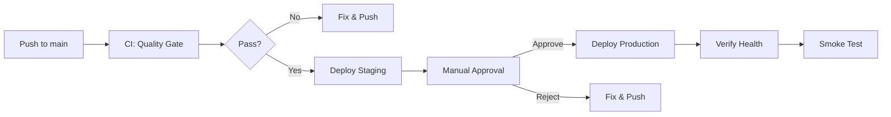

# Deployment & Rollback Runbook
**Hinabangan NHS School Management System**
*Version: 1.0 | Last Updated: 2026-10-11*

---

## Quick Reference

| Environment | URL | Render Service | Database |
|-------------|-----|----------------|----------|
| **Production** | `https://hinabangan-nhs.onrender.com` | `hinabangan-nhs` | Neon `main` branch |
| **Staging** | `https://hinabangan-nhs-staging.onrender.com` | `hinabangan-nhs-staging` | Neon `staging` branch |

**Deploy Trigger**: Push to `main` branch → CI runs → Auto-deploy staging → Manual approval → Deploy prod

---

## 1. Prerequisites

### Accounts Needed
- GitHub (repo admin)
- Render (owner/admin on `hinabangan-nhs` team)
- Neon (project owner)
- Cloudflare R2 (for uploads/backups - optional but recommended)

### Secrets (Configure in GitHub → Settings → Secrets)
| Secret | Description | Where Used |
|--------|-------------|------------|
| `RENDER_STAGING_DEPLOY_HOOK_URL` | Render deploy hook for staging | CI: `deploy-staging` job |
| `RENDER_PROD_DEPLOY_HOOK_URL` | Render deploy hook for production | CI: `deploy-prod` job |
| `SLACK_WEBHOOK_URL` | Optional: failure notifications | CI: `notify-failure` job |
| `SENTRY_DSN` | Server error tracking | Render env var |
| `VITE_SENTRY_DSN` | Web error tracking | Render env var |

### Render Environment Variables (Set in Dashboard)
| Variable | Staging | Production | Notes |
|----------|---------|------------|-------|
| `DATABASE_URL` | Neon staging branch | Neon main branch | **Never commit** |
| `APP_URL` | `https://hinabangan-nhs-staging.onrender.com` | `https://hinabangan-nhs.onrender.com` | For password reset links |
| `JWT_SECRET` | Auto-generated | Auto-generated | Render generates on first deploy |
| `SUPERADMIN_PASSWORD` | Set once before first deploy | Set once before first deploy | 8+ chars, ignored after first boot |
| `SMTP_*` | Optional | Required for prod | Email notifications |
| `R2_*` | Optional | Recommended | File uploads/backups |

---

## 2. Deployment Flow



### Step-by-Step

#### 1. Developer Pushes to Main
```bash
git add .
git commit -m "feat: description of changes"
git push origin main
```

#### 2. CI Runs Automatically (GitHub Actions)
- **Quality Gate** (`check` job):
  - `npm ci` (install deps)
  - `gitleaks` (secret scan)
  - `npm audit --audit-level=high` (vulnerability scan)
  - `npm run check` (lint, typecheck, build, i18n, tests)
- **Time**: ~3-5 minutes
- **Failure**: Check Actions tab, fix, push again

#### 3. Staging Auto-Deploys
- Triggered by `deploy-staging` job after `check` passes
- Calls `RENDER_STAGING_DEPLOY_HOOK_URL`
- Render builds & deploys `hinabangan-nhs-staging`
- **Time**: ~5-10 minutes (free tier cold start)

#### 4. Manual Approval Required
- GitHub Actions pauses at `approval` job
- Review staging: `https://hinabangan-nhs-staging.onrender.com`
- Run smoke tests (see Section 4)
- Click **Approve** in Actions UI to continue

#### 5. Production Deploys
- Triggered by `deploy-prod` job after approval
- Calls `RENDER_PROD_DEPLOY_HOOK_URL`
- Render builds & deploys `hinabangan-nhs`
- **Time**: ~5-10 minutes

#### 6. Post-Deploy Verification
- Check health: `https://hinabangan-nhs.onrender.com/api/v1/health`
- Verify login works with test account
- Check Render logs for errors

---

## 3. Rollback Procedure

### Option A: Render Dashboard (Fastest, ~2 min)
1. Go to Render Dashboard → **hinabangan-nhs** (or staging)
2. Click **Deploy** → **Deploy Latest Commit**
3. Select the **previous successful commit** (green checkmark)
4. Click **Deploy**
5. Wait for deploy to complete (~5 min)

### Option B: Git Revert + Push (Cleaner, ~10 min)
```bash
# Find the commit to revert to
git log --oneline -10

# Revert the bad commit(s)
git revert <bad-commit-sha>
# OR revert a range
git revert <old-good-sha>..HEAD

# Push to trigger redeploy
git push origin main
```

### Option C: Render CLI (If installed)
```bash
render deploy create --service hinabangan-nhs --commit <good-commit-sha>
```

### Database Rollback (If migration broke)
**Neon Branch Reset** (Preferred):
1. Neon Console → **Branches** → Select `main` (or `staging`)
2. Click **Reset Branch** → Choose timestamp before bad migration
3. Confirm (this rewrites DB history - coordinate with team)

**Manual SQL Restore** (Last resort):
```bash
# From backup (if R2 configured)
npm run backup:list
npm run backup:drill  # tests restore to isolated schema
# Then manually restore from R2 or pg_dump
```

---

## 4. Smoke Test Checklist

Run after **every** deployment (staging & prod):

| Test | How | Expected |
|------|-----|----------|
| Health endpoint | `curl https://<url>/api/v1/health` | `{"ok":true,"db":"connected"}` |
| Login | Open URL, sign in as `superadmin` | Dashboard loads |
| API auth | `curl -H "Authorization: Bearer <token>" /api/v1/users` | 200 with user list |
| Static assets | Open DevTools → Network → Check `/assets/` | 200, `cache-control: max-age=31536000` |
| File upload | Upload a test image in any module | File appears, accessible via R2 URL |
| Email (if SMTP) | Trigger "Forgot password" | Email received (check logs if not) |
| Operating hours | Visit outside 06:00-24:00 Manila | 423 response with friendly message |

**If any test fails → ROLLBACK IMMEDIATELY**

---

## 4. Common Issues & Fixes

| Symptom | Cause | Fix |
|---------|-------|-----|
| Deploy stuck at "Build" | `npm ci` fails (lockfile mismatch) | Check CI logs, fix `package-lock.json` |
| Deploy stuck at "Start" | Port binding / health check fail | Check logs: `PORT` env, `/api/v1/health` returns 200 |
| "Database unavailable" | `DATABASE_URL` wrong / Neon asleep | Verify Neon connection string, wake DB |
| Login fails | `JWT_SECRET` mismatch / DB not seeded | Check `SEED_ON_BOOT=1`, verify `JWT_SECRET` |
| Assets 404 | Web build not copied | Check `npm run build` output, `web/dist` exists |
| CORS error | `APP_URL` not set / wrong | Set correct `APP_URL` in Render env |
| Free tier cold start | Service slept >15 min | Wait 30-60s, refresh; upgrade to paid for always-on |
| CI fails at "Dependency audit" | New high/cseverity advisory | See §4a below |

### 4a. Dependency audit gate

`npm run audit` (`scripts/audit.mjs`) runs on every push and PR. It **fails the
build** on any high/critical vulnerability, except ones explicitly justified in
its `ALLOWLIST`.

Currently allowlisted (1 entry):

| Advisory | Packages | Why it is not fixed |
|---|---|---|
| GHSA-vfj7-8cjw-p6xm | `braces` (via `@sentry/vite-plugin` → `unplugin` → `chokidar`) | **No upstream fix exists.** The advisory covers `braces <=3.0.3` and 3.0.3 is the newest published version, so there is nothing to upgrade to. It is **build-time only** (runs in `vite build`, never shipped in the runtime image) and the flaw needs attacker-controlled glob patterns, which this repo does not accept from users. |

**Do not run `npm audit fix --force`.** npm suggests two changes that would break
working features:
- downgrade `exceljs` 4.4.0 → 3.4.0 (breaks Excel export)
- jump `@sentry/vite-plugin` 3 → 5 (untested major, and the plugin is imported
  unconditionally in `vite.config.js`, so a bad upgrade breaks *every* build)

**Re-evaluate** when `@sentry/vite-plugin` v5+ is adopted. The `uuid` advisory
(moderate, via `exceljs`) is below the gate threshold and not attacker-reachable
— `exceljs` uses v4 UUIDs, while the advisory affects v3/v5/v6 with a caller-
provided `buf`.

---

## 5. First-Time Production Setup

### 1. Create Neon Database
1. Go to https://neon.tech → New Project → Region: **Singapore**
2. Copy connection string (direct, not pooled)
3. In Render → **hinabangan-nhs** → **Environment** → Set `DATABASE_URL`

### 2. Configure Render Services
1. Render Dashboard → **New** → **Blueprint** → Connect GitHub repo
2. Render reads `render.yaml`, creates both services
3. Set all `sync: false` env vars in each service dashboard

### 3. First Boot & Superadmin
1. First deploy runs migrations + seeds automatically
2. Superadmin password:
   - If `SUPERADMIN_PASSWORD` set: uses that value
   - Else: random password printed in **Render logs** (one-time)
3. Sign in at `https://hinabangan-nhs.onrender.com`
4. **Immediately change password**: Key icon → Change password

### 4. Create Staff Accounts
1. Users module → Add users for: admin, registrar, teachers, etc.
2. Assign roles per DepEd matrix (19 roles available)

### 5. Configure Notifications (Optional)
- SMTP: `SMTP_HOST`, `SMTP_PORT`, `SMTP_USER`, `SMTP_PASS`, `MAIL_FROM`
- SMS: `SMS_PROVIDER_URL`, `SMS_PROVIDER_TOKEN`, `SMS_SENDER`
- Test: "Forgot password" flow

### 6. Enable Backups (Optional but Recommended)
1. Create Cloudflare R2 bucket
2. Set `R2_ENDPOINT`, `R2_BUCKET`, `R2_ACCESS_KEY`, `R2_SECRET_KEY`
3. Backups run daily at 02:00 Manila, retain 5, upload to R2

---

## 6. Scaling & Upgrades

| Need | Action | Cost |
|------|--------|------|
| Always-on (no sleep) | Render paid plan: **Starter** ($7/mo) per service | $14/mo (staging + prod) |
| More CPU/RAM | Render **Standard** ($25/mo) per service | $50/mo |
| Larger DB | Neon **Scale** plan ($19/mo) | $19/mo |
| Custom domain | Add CNAME in Render → Settings → Custom Domains | Free (DNS only) |
| CDN/Edge cache | Cloudflare free tier in front of Render | Free |

---

## 7. Emergency Contacts

| Role | Name | Contact |
|------|------|---------|
| Primary DevOps | [Name] | [Phone/Slack] |
| Backup DevOps | [Name] | [Phone/Slack] |
| Neon Support | - | https://neon.tech/support |
| Render Support | - | https://render.com/support |

---

## 8. Related Documentation

- `docs/31-cloud-deployment.md` - Full cloud deployment guide
- `docs/32-monitoring-setup.md` - Monitoring & alerting setup
- `docs/19-backup-strategy.md` - Backup & restore procedures
- `docs/20-disaster-recovery.md` - DR plan
- `AGENTS.md` - Development guidelines