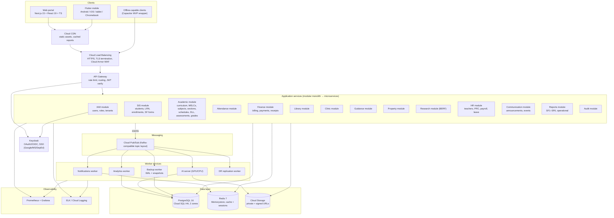
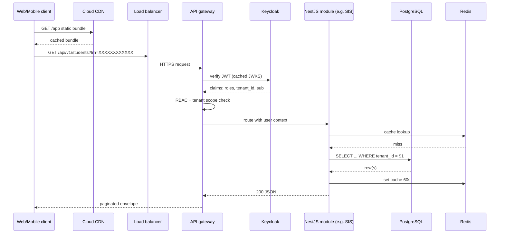

# System Architecture

MeridianEd is a secure, cloud-native, AI-powered, mobile-first school management
ecosystem that centralizes academic, administrative, financial, HR, health,
guidance, research, and operational data for elementary schools, junior/senior
high schools, colleges, universities, school divisions, and regional offices.
This document describes the **target production architecture**: a layered
Google Cloud Platform (GCP) deployment serving web, mobile, and tablet clients
in the Philippine K-12 (DepEd) market and beyond. MeridianEd is a placeholder
brand — the name is rebrandable at any time.

> **MVP note**: the runnable MVP in this repo uses the same concepts at a
> smaller scale: Express (Node 22) + PostgreSQL with a `node:sqlite` local
> fallback, React 19 + Vite web portal, and a Capacitor 8 Android wrapper.
> Section 7 maps the target layers to the MVP equivalents. Production features
> described here exceed what the MVP implements.

## 1. Architecture at a glance

The target architecture is a **modular monolith with service-extraction
boundaries**, deployed on GCP. All traffic enters through a single external load
balancer; authentication is delegated to Keycloak (OAuth2/OIDC); the application
core is a set of NestJS modules that may be extracted into microservices as load
or compliance demands; PostgreSQL 16 is the system of record, Redis 7 the cache,
and Google Cloud Storage the object store. Asynchronous work (notifications,
analytics, AI, backups, DR) runs on worker services fed by Pub/Sub.

Key numbers (applied consistently across all documents):

| Metric | Target |
|---|---|
| Availability | 99.9% (multi-zone, no single point of failure) |
| RPO | <= 15 minutes (continuous WAL archiving + nightly snapshots) |
| RTO | <= 4 hours region failover; <= 15 min database HA |
| Sessions | JWT access 15 min + refresh 14 days (rotation, revocation) |
| Audit log | Immutable, append-only, retained 7 years (DepEd/RA 10173) |

## 2. Architectural diagram

## 3. Layer descriptions

### 3.1 Presentation layer

| Client | Tech | Notes |
|---|---|---|
| Web portal | Next.js 15 + React 19 + TypeScript | SSR for SEO of public pages; role-aware dashboards |
| Mobile/tablet | Flutter 3 (Android 9+, iOS, Chromebook) | First-class citizen; offline-first sync for attendance and grades |
| Kiosk / offline | Capacitor web wrapper | Reuses the web build; queues writes when offline |

Clients MUST NOT call the database or Keycloak directly; all data access goes
through the API gateway. Public content (announcements, calendar) MAY be served
from CDN caches without authentication.

### 3.2 Delivery layer

Cloud CDN caches static assets and signed public resources; Cloud Load
Balancing terminates TLS, and Cloud Armor provides WAF rules (OWASP baseline)
and rate limiting. This layer absorbs DDoS and flash traffic from a school
division's parents (e.g., enrollment week).

### 3.3 API layer

The API gateway terminates public REST endpoints under `/api/v1`, validates
Bearer JWTs (signature verified against Keycloak's JWKS, cached), enforces
RBAC roles, applies tenant-scope checks, and routes to application services.
Internal service calls bypass the gateway on a private network.

### 3.4 Application services layer

A NestJS (Node 22, TypeScript) **modular monolith**: modules share a single
PostgreSQL connection pool and transaction context, which keeps grade entry
atomic. Extraction boundaries exist; the Finance, Reports, Research, and HR
modules are first candidates to become microservices when load or isolation
demands it. Communication between services is event-driven (Pub/Sub), never
synchronous HTTP between modules in the monolith stage.

| NestJS module | Core responsibilities | Module group |
|---|---|---|
| IAM | Users, roles, permissions, tenant tree, Keycloak federation | System Admin |
| SIS | Students, LRN, guardians, enrollments, SF1–SF6 data | Student Information System |
| Academic | Curriculum, MELCs/competencies, subjects, sections, schedules, DLL, assessments, grades, report cards | Academic Management |
| Attendance | Daily attendance, absences, holidays | Attendance |
| Finance | Billing, payments, receipts (PHP) | Finance |
| Library | Catalog, circulation | Library |
| Clinic | Visits, medicines, immunizations | Clinic |
| Guidance | Cases, intervention sessions | Guidance |
| Property | Asset register, PAR/ICS, movements | Property Management |
| Research | BERF proposals, reviews | Research |
| HR | Teacher/PRC profiles, payroll runs, leave | Teacher Management / HR |
| Communication | Announcements, events, notifications | Communication |
| Reports | SF1–SF6 + operational exports | Reports |
| Audit | Immutable audit_logs, 7-year retention | System Admin |
| AI assistant | RAG over MELCs and DLLs, grade analytics hints | AI Features |

### 3.5 Data layer

- **PostgreSQL 16 (Cloud SQL, HA across 2 zones)** — system of record. Tenancy
  via `tenant_id` rows and row-level scoping; LRN stored as 12-digit
  `XXXXXXXXXXXX` identifiers.
- **Redis 7 (Memorystore)** — cache for sessions, dashboard rollups, hot class
  records; expiry-driven invalidation.
- **Cloud Storage** — private buckets for SF-form PDFs, student documents, DLL
  attachments; access via short-lived signed URLs (no public exposure, RA 10173
  compliant).

### 3.6 Messaging layer

Cloud Pub/Sub carries domain events (`grade.submitted`, `payment.recorded`,
`enrollment.created`). Topic layout follows Kafka naming conventions
(`sis.grades.submitted`) so a future managed Kafka (Confluent) can replace it
without consumer changes. At-least-once delivery; consumers MUST be idempotent.

### 3.7 Worker services

| Worker | Consumes | Produces |
|---|---|---|
| Notifications | all domain events | Push/in-app notifications via Redis + FCM |
| Analytics | enrollment, attendance, grade events | Rollup tables, dashboard KPIs |
| AI | DLL drafts, MELC queries, grade trends | Suggestions, summaries (see AI server) |
| Backup | nightly schedule + WAL | PITR archives, snapshots (RPO <= 15 min) |
| DR | WAL + snapshots | Cross-region replication to DR region |

### 3.8 AI server

A separate service (CPU for RAG; optional GPU for fine-tuning) with its own
scaling policy so model inference cannot starve the API. Reads PostgreSQL
snapshots and object storage, writes results back through the API or directly
to `ai_logs`. All AI outputs are logged for auditability (RA 10173).

### 3.9 Observability

Prometheus scrapes API, workers, and PostgreSQL exporters; Grafana dashboards
cover SLO burn (99.9%) and module latency. Structured logs flow to ELK/Cloud
Logging; audit_logs are written transactionally with business writes, never via
the log pipeline.

## 4. Request lifecycle example

## 5. Grade entry data flow

A teacher enters quarterly component scores (Written Works, Performance Tasks,
Quarterly Assessment) for one section:

1. **Validation** — the API validates the teacher owns the section (adviser or
   subject load), the school year is open, and scores respect max values.
2. **Transactional write** — grades rows are written in one transaction with an
   `audit_logs` entry (who, what, old/new values, IP) and a bump of the class
   record cache version.
3. **Event publish** — `sis.grades.submitted` is published to Pub/Sub.
4. **Notifications worker** — notifies the principal (in-app push) that class
   records were transmitted; parents receive only the final, approved report
   card (never interim scores) to respect grading policy.
5. **Analytics worker** — updates the grade-distribution rollup and flags
   at-risk learners for the guidance module.
6. **AI worker** — appends a trend summary to `ai_logs` (e.g., "quarter 2
   Written Works dropped 8% in Math 8"); suggestions are advisory only.
7. **Reports** — SF5/SF6 regeneration is triggered for the affected grade level
   when the teacher finalizes the class record (`POST /grades/submit`).

The whole path is idempotent: replaying `sis.grades.submitted` must not double
count (upsert on natural keys).

## 6. Modular monolith to microservices

| Stage | Structure | Trigger to extract |
|---|---|---|
| MVP | Single Express process, inline jobs | — |
| 1. Target | NestJS modular monolith + workers | initial production |
| 2. Extract Finance + Reports | Independent services behind gateway | > ~10k students/division or regulatory isolation |
| 3. Extract AI | Dedicated AI server (already separate) | model load, PCI/DPA needs |
| 4. Extract HR/Payroll | Independent service | BIR/SSS integrations, payroll windows |

Extraction preserves the module boundaries above; the gateway and event topics
are stable interfaces, so extraction is a deployment change, not a redesign.

## 7. MVP architecture (this repo)

The runnable MVP collapses the target layers without changing the concepts:

| Target layer | MVP equivalent |
|---|---|
| Web portal (Next.js) | React 19 + Vite portal in `web/` |
| Flutter mobile | Capacitor 8 Android wrapper of the web build in `android/` |
| API gateway + Keycloak | Express app in `server/`; JWT signed by the API itself |
| NestJS modules | Express route modules in `server/src/routes/` |
| PostgreSQL / Redis | PostgreSQL with `node:sqlite` local fallback in `server/`; no Redis |
| Pub/Sub workers | Inline jobs and simple scheduled tasks in the Express process |
| CDN / LB / WAF | Not present; direct HTTPS to the API |
| Prometheus / ELK | Basic request logging; no metrics stack |
| Cloud Storage | Local uploads directory |

The MVP implements the core academic loop — students, teachers, subjects,
sections, enrollments, attendance, grades, announcements, audit — so the target
architecture is exercised end to end at small scale.

---
*MeridianEd — Cloud-Based School Management Ecosystem — Deliverable 5 of 30.*
