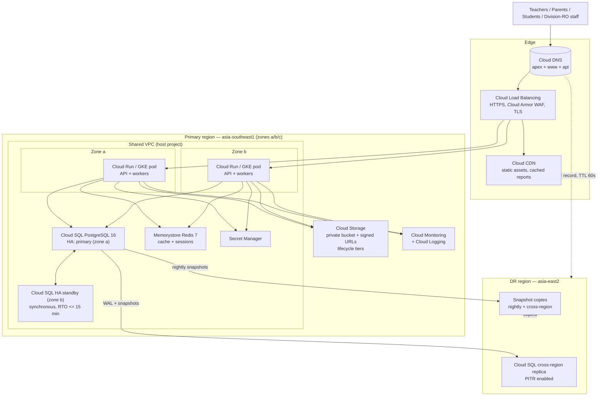

# Cloud Infrastructure Diagram

MeridianEd is a secure, cloud-native, AI-powered, mobile-first school management
ecosystem that centralizes academic, administrative, financial, HR, health,
guidance, research, and operational data for elementary schools, junior/senior
high schools, colleges, universities, school divisions, and regional offices.
This document details the target production infrastructure on Google Cloud
Platform (GCP): regions and zones, VPC design, load balancing, compute,
PostgreSQL HA, Redis, object storage, CDN, secrets, IAM, monitoring, backup,
and disaster recovery. MeridianEd is a placeholder brand — the name is
rebrandable at any time.

> **MVP note**: the runnable MVP in this repo runs without cloud services (local
> PostgreSQL or `node:sqlite`). Section 9 lists a free-tier-friendly MVP path
> that keeps monthly spend near zero.

## 1. Regions, zones, and latency

| Region | Role | Zones | Notes |
|---|---|---|---|
| `asia-southeast1` (Singapore) | Primary | a, b, c | Lowest latency to the Philippines from GCP; primary timezone Asia/Manila (UTC+8) |
| `asia-east2` (Taiwan) | DR (secondary) | a, b, c | Cross-region replica + standby DNS; RTO <= 4 hours |
| `us-central1` (optional) | Analytics/batch mirror | a, b, c | Only for AI training jobs; no live traffic |

Users in the Philippines experience ~40–70 ms to `asia-southeast1`; this is
acceptable for REST APIs. Static assets are served from Cloud CDN edge POPs
(including Manila points of presence where available).

## 2. High-level diagram

## 3. VPC design

- **Shared VPC** in a host project with one subnet per environment
  (dev, staging, prod) in the primary region; a second subnet in the DR region.
- **Cloud SQL uses private IP only** (`10.x.x.x`); no public database exposure.
- **Memorystore** is reached over VPC peering; Redis auth enabled.
- **Cloud NAT** for egress from private workloads (API calls to DepEd/external
  services, Keycloak federation).
- **VPC Service Controls** perimeter around buckets, Cloud SQL, and secrets to
  satisfy RA 10173 data-protection expectations for learner records.
- **IAM**: least privilege. Service accounts per workload; API service account
  cannot list secrets; workers cannot write to the primary bucket namespace.

## 4. Compute

| Workload | Compute | Notes |
|---|---|---|
| API (modular monolith) | Cloud Run services (autoscaling) | Stateless; scale to 0 outside school hours |
| Workers (notifications, analytics, AI, backup, DR) | Cloud Run jobs / GKE (later) | Cron triggers + Pub/Sub pull |
| Mobile/web builds | GitHub Actions | See Deliverable 21 |

GKE is the target for larger deployments where node affinity matters (heavy
report generation); Cloud Run is used first because it removes node management.
Both are drawn behind the same load balancer in the diagram.

## 5. Component table

| Component | Purpose | Production cost note (approx, subject to change) |
|---|---|---|
| Cloud Load Balancing (HTTPS) | Ingress, TLS, WAF, autoscaling | ~$18/mo base + data transfer; single ingress for all services |
| Cloud CDN | Cache static assets, public reports | ~$0.01/GB cache egress; enabled on web bucket only |
| Cloud Run | Stateless API + workers | Pay-per-request; generous free quota; lowest-cost production compute |
| GKE (Autopilot) | Orchestration, cron, heavy jobs | Autopilot ~$60–$120/mo for prod baseline; add only when needed |
| Cloud SQL PostgreSQL 16 HA | System of record, 2 zones | Micro ~$7.7/mo (MVP); HA prod ~$150–$400/mo depending on tier |
| Memorystore Redis 7 | Cache, sessions, queues | Basic tier ~$35/mo minimum; omit in MVP |
| Cloud Storage | Objects, SF forms, documents, DLL files | ~$0.026/GB/mo standard; lifecycle moves old data to nearline (~50% cheaper) |
| Secret Manager | DB passwords, JWT keys, API keys | ~$0.06/secret/mo; near-zero cost |
| Cloud DNS | Apex, www, api records | ~$0.20/zone/mo |
| Cloud Monitoring + Logging | Metrics, SLO burn, logs | ~$0.20/GB log ingestion (approx); cap retention 30 days for app logs |
| Cloud Armor | WAF baseline + rate limits | ~$5/mo + per-request premium rules (optional) |

## 6. Cloud SQL HA, backups, and snapshots

- **HA**: primary in zone a, synchronous standby in zone b; automatic failover
  RTO <= 15 min, zero data loss on instance failure.
- **PITR**: continuous WAL archiving → point-in-time recovery with RPO <= 15 min;
  retention 7 days (aligns with audit retention; see Deliverable 19).
- **Snapshots**: nightly snapshots retained 14 days; one snapshot per night is
  copied to the DR region.
- **Cross-region replica** in `asia-east2` continuously applies WAL; promoted
  on declared regional disaster.

## 7. Storage design

| Bucket | Access | Lifecycle |
|---|---|---|
| `msp-documents` (private) | Signed URLs (15 min) only | Never public; 7-year retention for SF forms |
| `msp-uploads` (private) | Signed upload URLs | Scan with ClamAV before processing |
| `msp-public` (CDN-backed) | Public read | 30-day cache; used for announcements images |
| `msp-backups` (regional) | IAM-restricted | Nightly snapshots + WAL archives; coldline after 90 days |

Signed URLs are issued by the API only after RBAC + tenant checks, so files are
never exposed through static links (RA 10173).

## 8. DR and DNS failover

- Secondary region `asia-east2` holds a PITR-enabled replica, snapshot copies,
  and a standby Terraform workspace ready to deploy compute in minutes.
- Cloud DNS failover record (TTL 60 s) flips `api.meridened.ph` to the DR load
  balancer; health checks drive the flip automatically.
- DR target: RTO <= 4 hours, RPO <= 15 minutes. Runbooks in Deliverable 20.

## 9. MVP free-tier-friendly path

The MVP does not require this full footprint:

1. **Cloud Run** free tier for the API (2M requests/mo free).
2. **Cloud SQL micro** single-zone instance (~$7.7/mo) with PITR off until
   staging.
3. One **Cloud Storage** bucket for uploads; skip CDN, WAF, Memorystore, and GKE.
4. **Secret Manager** for the DB password and JWT signing key.
5. Deploy from GitHub Actions; no Terraform state in prod until the first real
   division signs on.

Estimated MVP cloud spend: under ₱1,000/month including Cloud SQL.

## 10. Cloud-agnostic mapping

- **AWS**: Cloud Run → App Runner/Fargate, Cloud SQL → RDS/Aurora PostgreSQL,
  Memorystore → ElastiCache, Cloud Storage → S3, Cloud CDN → CloudFront, Cloud
  Load Balancing → ALB/Route 53, Secret Manager → Secrets Manager, Cloud
  Monitoring → CloudWatch.
- **Azure**: Cloud Run → Container Apps/AKS, Cloud SQL → Azure Database for
  PostgreSQL, Memorystore → Azure Cache for Redis, Cloud Storage → Blob Storage,
  CDN → Azure Front Door/CDN, Secrets → Key Vault, Monitoring → Azure Monitor.

---
*MeridianEd — Cloud-Based School Management Ecosystem — Deliverable 6 of 30.*
