# Database ERD

MeridianEd is a secure, cloud-native, AI-powered, mobile-first school management
ecosystem that centralizes academic, administrative, financial, HR, health,
guidance, research, and operational data for elementary schools, junior/senior
high schools, colleges, universities, school divisions, and regional offices.
This document is the entity-relationship model for the **full product vision**:
50 tables grouped into domain clusters, tenanted by the region → division →
school hierarchy, with audit and AI logging as first-class citizens. The MVP
subsets this model (Section 3). MeridianEd is a placeholder brand — the name is
rebrandable at any time.

> **MVP note**: the runnable MVP in this repo implements only the core academic
> loop (see Section 3); every other entity below is production vision. The
> executable SQL lives in `../database/migrations/`.

## 1. Conventions

- Primary keys are `uuid` (or `bigserial` in the MVP); foreign keys named
  `<entity>_id`.
- Every tenant-scoped table carries `tenant_id` referencing `TENANTS`; row-level
  scoping follows the tree: a school row is visible to its division and region.
- Students are identified by DepEd LRN in the format `XXXXXXXXXXXX` (12 digits),
  unique per tenant.
- Timestamps are `timestamptz` in Asia/Manila (UTC+8). Money columns are
  `NUMERIC(12,2)` in PHP (₱).
- Soft deletes via `deleted_at`; hard deletes only for typo-level corrections.
- `AUDIT_LOGS` is append-only and immutable; `AI_LOGS` records every AI
  interaction for RA 10173 accountability.

## 2. Full-vision ERD

```mermaid
erDiagram
    %% Identity, RBAC, tenancy
    TENANTS ||--o{ TENANTS : "parent organization"
    TENANTS ||--o{ USERS : "employs"
    USERS ||--o{ USER_ROLES : "has"
    ROLES ||--o{ USER_ROLES : "granted to"
    ROLES ||--o{ ROLE_PERMISSIONS : "maps"
    PERMISSIONS ||--o{ ROLE_PERMISSIONS : "included in"
    USERS ||--o{ REFRESH_TOKENS : "issues"
    TENANTS ||--o{ APP_SETTINGS : "configures"
    TENANTS ||--o{ SCHOOL_YEARS : "defines"
    TENANTS ||--o{ SUBJECTS : "offers"
    TENANTS ||--o{ CURRICULUM : "adopts"
    TENANTS ||--o{ SECTIONS : "organizes"
    TENANTS ||--o{ ANNOUNCEMENTS : "posts"
    TENANTS ||--o{ EVENTS : "hosts"
    TENANTS ||--o{ DOCUMENTS : "stores"
    TENANTS ||--o{ BILLING_INVOICES : "bills"
    TENANTS ||--o{ LIBRARY_BOOKS : "catalogs"
    TENANTS ||--o{ CLINIC_MEDICINES : "stocks"
    TENANTS ||--o{ PROPERTY_ASSETS : "owns"
    TENANTS ||--o{ RESEARCH_PROPOSALS : "funds"
    TENANTS ||--o{ PAYROLL_RUNS : "pays"
    TENANTS ||--o{ AUDIT_LOGS : "trails"

    %% SIS
    TENANTS ||--o{ STUDENTS : "enrolls"
    STUDENTS ||--o{ STUDENT_GUARDIANS : "has"
    GUARDIANS ||--o{ STUDENT_GUARDIANS : "linked to"
    STUDENTS ||--o{ DOCUMENTS : "holds"
    STUDENTS ||--o{ BILLING_INVOICES : "charged"
    STUDENTS ||--o{ ENROLLMENTS : "enrolled in"
    STUDENTS ||--o{ ATTENDANCE : "marked"
    STUDENTS ||--o{ ASSESSMENT_RESULTS : "scored"
    STUDENTS ||--o{ CLASS_RECORDS : "graded in"
    STUDENTS ||--o{ REPORT_CARDS : "receives"
    STUDENTS ||--o{ CLINIC_VISITS : "consulted"
    STUDENTS ||--o{ GUIDANCE_CASES : "referred"

    %% Teacher management and HR
    TENANTS ||--o{ TEACHERS : "employs"
    TEACHERS ||--o{ TEACHER_ASSIGNMENTS : "loaded with"
    SUBJECTS ||--o{ TEACHER_ASSIGNMENTS : "assigned to"
    SECTIONS ||--o{ TEACHER_ASSIGNMENTS : "assigned to"
    TEACHERS ||--o{ DLL_LESSON_PLANS : "writes"
    TEACHERS ||--o{ RESEARCH_PROPOSALS : "submits"
    TEACHERS ||--o{ PAYROLL_RUNS : "included in"
    TEACHERS ||--o{ EMPLOYEE_LEAVES : "files"

    %% Academic management
    CURRICULUM ||--o{ CURRICULUM_SUBJECTS : "contains"
    SUBJECTS ||--o{ CURRICULUM_SUBJECTS : "listed in"
    SUBJECTS ||--o{ SUBJECT_COMPETENCIES : "covered by"
    COMPETENCIES ||--o{ SUBJECT_COMPETENCIES : "mapped to"
    SCHOOL_YEARS ||--o{ SECTIONS : "runs"
    SECTIONS ||--o{ ENROLLMENTS : "contains"
    SCHOOL_YEARS ||--o{ ENROLLMENTS : "period"
    SECTIONS ||--o{ CLASS_SCHEDULES : "timed"
    SUBJECTS ||--o{ CLASS_SCHEDULES : "scheduled"
    TEACHERS ||--o{ CLASS_SCHEDULES : "teaches"
    SECTIONS ||--o{ ATTENDANCE : "records"
    SECTIONS ||--o{ ASSESSMENTS : "administers"
    SUBJECTS ||--o{ ASSESSMENTS : "belongs to"
    ASSESSMENTS ||--o{ ASSESSMENT_RESULTS : "yields"
    SECTIONS ||--o{ CLASS_RECORDS : "summarized"
    SUBJECTS ||--o{ CLASS_RECORDS : "computed"
    CLASS_RECORDS ||--o{ ASSESSMENTS : "groups"
    CLASS_RECORDS ||--o{ REPORT_CARDS : "feeds"
    SCHOOL_YEARS ||--o{ REPORT_CARDS : "covers"
    SECTIONS ||--o{ DLL_LESSON_PLANS : "taught in"
    SUBJECTS ||--o{ DLL_LESSON_PLANS : "planned for"
    USERS ||--o{ ANNOUNCEMENTS : "authors"
    USERS ||--o{ BOOK_BORROWS : "borrows"
    USERS ||--o{ CLINIC_VISITS : "handled by"
    USERS ||--o{ GUIDANCE_SESSIONS : "conducted by"
    USERS ||--o{ RESEARCH_REVIEWS : "reviewed by"

    %% Finance
    BILLING_INVOICES ||--o{ PAYMENTS : "settled by"
    PAYMENTS ||--o{ RECEIPTS : "issued as"

    %% Library
    LIBRARY_BOOKS ||--o{ BOOK_BORROWS : "circulated in"

    %% Clinic
    CLINIC_MEDICINES ||--o{ MEDICINE_DISPENSES : "dispensed"
    CLINIC_VISITS ||--o{ MEDICINE_DISPENSES : "prescribed in"

    %% Guidance
    GUIDANCE_CASES ||--o{ GUIDANCE_SESSIONS : "documented in"

    %% Property
    PROPERTY_ASSETS ||--o{ ASSET_MOVEMENTS : "moved"

    %% Research
    RESEARCH_PROPOSALS ||--o{ RESEARCH_REVIEWS : "evaluated by"

    %% Cross-cutting
    USERS ||--o{ AI_LOGS : "prompts"
    USERS ||--o{ NOTIFICATIONS : "receives"
    USERS ||--o{ AUDIT_LOGS : "causes"
```

## 3. Domain clusters

| Cluster | Entities | Purpose |
|---|---|---|
| Identity & RBAC | USERS, ROLES, PERMISSIONS, USER_ROLES, ROLE_PERMISSIONS, REFRESH_TOKENS, APP_SETTINGS | AuthN/AuthZ; roles per style guide; session rotation; settings |
| Tenancy | TENANTS, SCHOOL_YEARS | Region → division → school tree; academic periods |
| SIS | STUDENTS, GUARDIANS, STUDENT_GUARDIANS, ENROLLMENTS, DOCUMENTS | LRN (XXXXXXXXXXXX), guardianship, enrollment status, SF forms |
| Teacher Mgmt / HR | TEACHERS, TEACHER_ASSIGNMENTS, PAYROLL_RUNS, EMPLOYEE_LEAVES | PRC numbers, teaching loads, payroll, leave |
| Academic | CURRICULUM, CURRICULUM_SUBJECTS, SUBJECTS, COMPETENCIES, SUBJECT_COMPETENCIES, SECTIONS, CLASS_SCHEDULES | K-12 curriculum, MELCs, sections, schedules |
| Assessment & Grading | ASSESSMENTS, ASSESSMENT_RESULTS, CLASS_RECORDS, REPORT_CARDS, DLL_LESSON_PLANS | Weighted components, class records, report cards, DLLs |
| Attendance | ATTENDANCE | Daily presence per section |
| Communication | ANNOUNCEMENTS, EVENTS, NOTIFICATIONS | Tenant-scoped broadcasts, calendar, in-app push |
| Finance | BILLING_INVOICES, PAYMENTS, RECEIPTS | Fees, ORs, PHP balances |
| Library | LIBRARY_BOOKS, BOOK_BORROWS | Catalog and circulation |
| Clinic | CLINIC_VISITS, CLINIC_MEDICINES, MEDICINE_DISPENSES | Health records, medicine stock |
| Guidance | GUIDANCE_CASES, GUIDANCE_SESSIONS | Referrals and interventions |
| Property | PROPERTY_ASSETS, ASSET_MOVEMENTS | PAR/ICS register, transfers |
| Research | RESEARCH_PROPOSALS, RESEARCH_REVIEWS | BERF pipeline |
| Cross-cutting | AUDIT_LOGS, AI_LOGS | Immutable audit (7 years), AI accountability |

## 4. MVP subset

The runnable MVP implements a subset of the ERD only:

| MVP table | Notes |
|---|---|
| users, roles, user_roles | Local auth; Keycloak later |
| students | LRN, guardian fields inline (denormalized) |
| teachers | PRC number fields |
| subjects, sections | With grade level and SHS strand |
| enrollments | Student → section per school year |
| grades | Single table for component scores (class record) |
| attendance | Daily status |
| announcements | Tenant-scoped feed |
| audit_logs | Append-only log of writes |

The MVP **does not** implement the finance, library, clinic, guidance, property,
research, HR/payroll, report_cards, assessments, or notification tables; their
schemas will arrive with the production releases described in the five-year
roadmap (Deliverable 30).

---
*MeridianEd — Cloud-Based School Management Ecosystem — Deliverable 7 of 30.*
