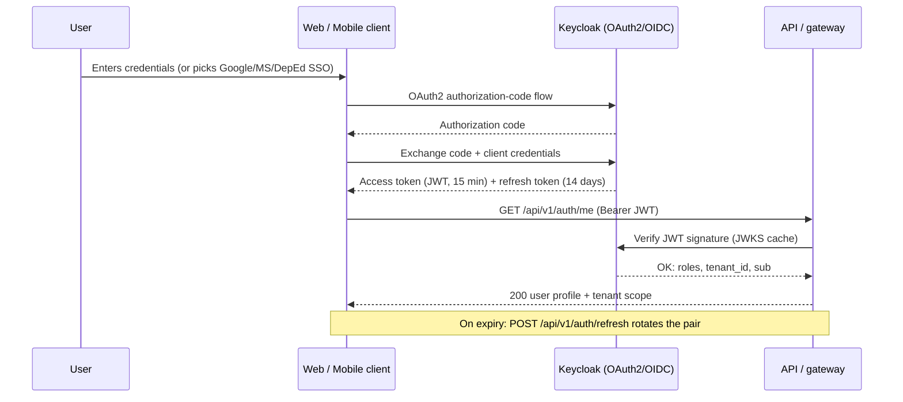

# API Documentation

MeridianEd is a secure, cloud-native, AI-powered, mobile-first school management
ecosystem that centralizes academic, administrative, financial, HR, health,
guidance, research, and operational data for elementary schools, junior/senior
high schools, colleges, universities, school divisions, and regional offices.
This document defines the REST API conventions for the target product and
catalogs the endpoint reference for every module, followed by the MVP endpoint
subset. MeridianEd is a placeholder brand — the name is rebrandable at any time.

> **MVP note**: the runnable MVP in this repo exposes the subset listed in
> Section 4 on an Express API. The full catalog below is production vision and
> may exceed MVP capabilities.

## 1. Conventions

| Item | Convention |
|---|---|
| Base URL | `https://api.meridened.ph` (placeholder domain) |
| Versioning | `/api/v1/...` in the URL path; breaking changes bump the version |
| Content type | `application/json` both ways; `multipart/form-data` for uploads |
| Timestamps | ISO 8601 UTC, e.g. `2026-08-11T04:30:00Z` |
| Money | Decimal string in PHP, e.g. `"2450.00"` |
| LRN | 12-digit string `XXXXXXXXXXXX` |
| IDs | UUID v4 for production; integer in the MVP |

### 1.1 Pagination envelope

All list endpoints return a stable envelope (never a bare array):

```json
{
  "data": [],
  "pagination": { "page": 1, "pageSize": 25, "total": 312, "totalPages": 13 }
}
```

Query parameters: `page` (1-based), `pageSize` (max 100), `sort`, `filter`
(JSON string or repeated `field=value`), and `q` for free-text search.

### 1.2 Error format

```json
{
  "error": { "code": "VALIDATION_FAILED", "message": "lrn must be 12 digits", "details": { "lrn": "must match XXXXXXXX" } }
}
```

| HTTP | code | Meaning |
|---|---|---|
| 400 | `VALIDATION_FAILED` | Malformed payload |
| 401 | `UNAUTHORIZED` | Missing/invalid token |
| 403 | `FORBIDDEN` | Role or tenant scope denied |
| 404 | `NOT_FOUND` | Resource absent in your tenant |
| 409 | `CONFLICT` | Duplicate LRN, duplicate enrollment |
| 429 | `RATE_LIMITED` | Too many requests |
| 500 | `INTERNAL` | Server fault (retryable for GET) |

### 1.3 Auth

Bearer JWT access token (15 min) in the `Authorization` header; refresh token
(14 days, rotating, revocable) exchanged via `POST /auth/refresh`. Passwords:
minimum 12 characters, 90-day expiry, 5 failed attempts → 15-min lockout.
All write endpoints require `X-Idempotency-Key` support for retries.



## 2. Endpoint reference

Roles abbreviated: SA `super_admin`, RA `region_admin`, DA `division_admin`,
SAD `school_admin`, P `principal`, AP `assistant_principal`, REG `registrar`,
T `teacher`, G `guidance`, N `nurse`, L `librarian`, C `cashier`, AC
`accounting`, HR `hr`, PC `property_custodian`, ICT `ict`, ST `student`,
PA `parent`, AU `authenticated user`.

### 2.1 Auth

| Method | Path | Auth | Description |
|---|---|---|---|
| POST | /auth/login | Public | Exchange OAuth2 code or credentials for token pair |
| POST | /auth/refresh | Public | Rotate refresh token; issue new pair |
| POST | /auth/logout | AU | Revoke refresh token and session |
| GET | /auth/me | AU | Profile, roles, tenant scope |
| POST | /auth/change-password | AU | Change own password (90-day expiry enforced) |

### 2.2 Users and RBAC

| Method | Path | Auth | Description |
|---|---|---|---|
| GET | /users | SA, RA, DA | List users, tenant-scoped, paginated |
| POST | /users | SA, RA, DA | Create user and assign roles |
| PATCH | /users/:id | SA, RA, DA | Update profile, status, tenant |
| POST | /users/:id/roles | SA | Grant/revoke roles |
| GET | /roles | SA, RA, DA | List roles and permissions |

### 2.3 Students

| Method | Path | Auth | Description |
|---|---|---|---|
| GET | /students | SAD, P, REG, T, G, N | List students (filters: LRN, name, grade level, status) |
| POST | /students | REG | Create student; assign LRN `XXXXXXXXXXXX` |
| PATCH | /students/:id | REG | Update demographics |
| GET | /students/search?lrn= | REG, P, SAD | Lookup by 12-digit LRN |
| POST | /students/import | REG | Bulk import SF1 data (CSV) |

### 2.4 Teachers

| Method | Path | Auth | Description |
|---|---|---|---|
| GET | /teachers | SAD, HR, P | List teachers |
| POST | /teachers | HR, SAD | Create teacher profile (PRC no., validity) |
| GET | /teachers/:id/assignments | SAD, HR, T | Teaching loads and advisory section |

### 2.5 Subjects and curriculum

| Method | Path | Auth | Description |
|---|---|---|---|
| GET | /subjects | SAD, T, REG | List subjects (per curriculum and grade level) |
| POST | /subjects | SAD | Create subject (code, name, credits) |
| GET | /curriculum/competencies | SAD, T | MELC list with codes, filter by subject/grade |
| POST | /subjects/:id/competencies | SAD, T | Link MELCs to a subject |

### 2.6 Sections

| Method | Path | Auth | Description |
|---|---|---|---|
| GET | /sections | SAD, P, T | List sections (school year, grade level, strand) |
| POST | /sections | SAD | Create section with adviser |
| GET | /sections/:id/schedule | SAD, T, ST, PA | Class schedule for the section |

### 2.7 Enrollment

| Method | Path | Auth | Description |
|---|---|---|---|
| GET | /enrollments | REG, SAD, P | List enrollments (school year filter) |
| POST | /enrollments | REG | Enroll student into a section |
| PATCH | /enrollments/:id | REG | Change status (pending → enrolled → dropped/transferred) |

### 2.8 Attendance

| Method | Path | Auth | Description |
|---|---|---|---|
| GET | /attendance | T, SAD, P | Daily attendance per section/date |
| POST | /attendance/batch | T | Mark present/late/absent/excused for a section |
| GET | /attendance/student/:studentId | T, P, SAD | Summary: days present, absent, late |

### 2.9 Grades

| Method | Path | Auth | Description |
|---|---|---|---|
| GET | /grades | T | Class record view (section × subject, weighted components) |
| POST | /grades/batch | T | Enter scores for an assessment/component |
| PUT | /grades/:id | T | Correct a single grade entry |
| POST | /grades/submit | T | Finalize and transmit class record (audit + notify principal) |
| GET | /grades/report-card/:studentId | REG, P, PA | Computed report card summary |

### 2.10 Announcements

| Method | Path | Auth | Description |
|---|---|---|---|
| GET | /announcements | AU | Feed, tenant-scoped, published only |
| POST | /announcements | SAD, P | Create announcement |
| PATCH | /announcements/:id | SAD, P | Update (author or admin) |
| POST | /announcements/:id/publish | SAD | Publish or schedule publishing |

### 2.11 Dashboard stats

| Method | Path | Auth | Description |
|---|---|---|---|
| GET | /dashboard/overview | AU | Role-aware KPI cards |
| GET | /dashboard/school | SAD, P | Enrollment, attendance, grade distribution |
| GET | /dashboard/region-division | RA, DA | Multi-school rollup |

### 2.12 Finance

| Method | Path | Auth | Description |
|---|---|---|---|
| GET | /finance/invoices | C, AC, SAD | List invoices (student, status, balance) |
| POST | /finance/invoices | AC | Generate invoice (tuition and fees, PHP) |
| GET | /finance/invoices/:id | C, AC, PA | Invoice detail and outstanding balance |
| POST | /finance/invoices/:id/payments | C | Record payment; issue OR number |
| GET | /finance/receipts/:id | C, AC, PA | Official receipt copy |

### 2.13 Library

| Method | Path | Auth | Description |
|---|---|---|---|
| GET | /library/books | L, AU | Catalog search (title, author, ISBN) |
| POST | /library/books | L | Add book |
| POST | /library/borrows | L | Check out (member, due date) |
| POST | /library/borrows/:id/return | L | Check in; compute fines |

### 2.14 Clinic

| Method | Path | Auth | Description |
|---|---|---|---|
| GET | /clinic/visits | N, SAD | Visit log |
| POST | /clinic/visits | N | Record consultation and findings |
| GET | /clinic/medicines | N | Medicine inventory |
| PATCH | /clinic/medicines/:id | N | Adjust stock (dispense/restock) |

### 2.15 Guidance

| Method | Path | Auth | Description |
|---|---|---|---|
| GET | /guidance/cases | G, SAD, P | Case list |
| POST | /guidance/cases | G | Open a case for a learner |
| GET | /guidance/cases/:id | G, P | Case details and session history |
| POST | /guidance/cases/:id/sessions | G | Log an intervention session |

### 2.16 Property

| Method | Path | Auth | Description |
|---|---|---|---|
| GET | /property/assets | PC, SAD | Asset register |
| POST | /property/assets | PC | Add asset (PAR/ICS numbers) |
| PATCH | /property/assets/:id | PC | Update asset details |
| POST | /property/assets/:id/movements | PC | Record transfer or disposal |

### 2.17 Research

| Method | Path | Auth | Description |
|---|---|---|---|
| GET | /research/proposals | T, DA, RA | BERF proposals |
| POST | /research/proposals | T | Submit BERF proposal |
| GET | /research/proposals/:id | T, DA, RA | Proposal detail and decision |
| POST | /research/proposals/:id/review | DA | BERF evaluation and funding decision |

### 2.18 Reports

| Method | Path | Auth | Description |
|---|---|---|---|
| GET | /reports/sf1 | REG, SAD | School Form 1 (learner profile, with LRN) |
| GET | /reports/sf2 | REG, SAD | SF2 daily attendance |
| GET | /reports/sf4 | REG, SAD | SF4 monthly report of promotion |
| GET | /reports/sf5 | REG, SAD | SF5 report on promotion/graduation |
| GET | /reports/sf6 | REG, SAD | SF6 summarized report |

### 2.19 Notifications

| Method | Path | Auth | Description |
|---|---|---|---|
| GET | /notifications | AU | Inbox, paginated |
| POST | /notifications/send | SAD, DA, RA | Targeted push (role, section, tenant) |
| PATCH | /notifications/:id/read | AU | Mark read |

### 2.20 Audit

| Method | Path | Auth | Description |
|---|---|---|---|
| GET | /audit/logs | SA, ICT | Immutable trail, paginated (7-year retention) |
| GET | /audit/logs/:entity/:id | SA | History for one record |
| GET | /audit/summary | SA | Aggregated activity (users, actions, IPs) |

## 3. Example payloads

```json
// POST /api/v1/students
{ "lrn": "136708120034", "firstName": "Maria", "middleName": "Santos",
  "lastName": "Dela Cruz", "birthDate": "2012-04-15", "sex": "F",
  "gradeLevel": 7, "guardianName": "Juan Dela Cruz", "guardianPhone": "09171234567" }

// 201 Created
{ "data": { "id": "9f8b...", "lrn": "136708120034", "status": "enrolled" } }
```

## 4. MVP endpoint subset

The runnable MVP implements: 2.1 Auth (login, refresh, me, change-password),
2.2 Users/RBAC (list, create), 2.3 Students, 2.4 Teachers, 2.5 Subjects,
2.6 Sections, 2.7 Enrollment, 2.8 Attendance, 2.9 Grades, 2.10 Announcements,
2.11 Dashboard (overview, school), and 2.20 Audit (list). All other modules
(Finance through Reports) exist only in the production vision and will be
released incrementally per the roadmap (Deliverable 30).

---
*MeridianEd — Cloud-Based School Management Ecosystem — Deliverable 8 of 30.*
