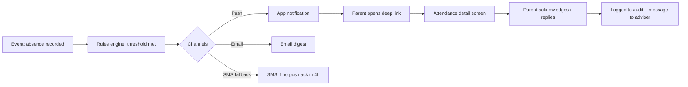
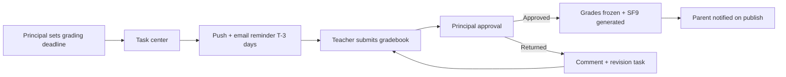
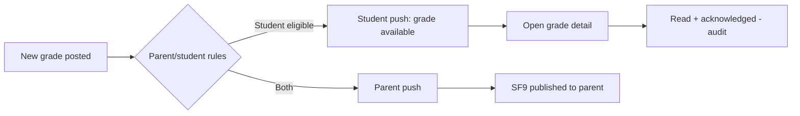

# MeridianEd — Parent, Teacher, and Student Portals

MeridianEd is a secure, cloud-native, AI-powered, mobile-first school management
ecosystem that centralizes academic, administrative, financial, HR, health,
guidance, research, and operational data for elementary schools, junior/senior
high schools, colleges, universities, school divisions, and regional offices.
This deliverable covers the three primary user portals (parent, teacher,
student): feature sets, screen sketches, notification flows, and the split
between MVP scope and vision. All three portals are responsive web views of the
same platform and share the design system in deliverable 10.

> MeridianEd is a placeholder brand — the name is rebrandable at any time.

## 1. Parent Portal

### 1.1 Features

| ID | Feature | Detail | Scope |
|---|---|---|---|
| PF-01 | Learner overview | Card per child: attendance, latest grades, next payment due, announcements | MVP |
| PF-02 | Attendance history | Daily statuses with late/absent reasons; month view | MVP |
| PF-03 | Grades | Quarterly and transmuted grades per subject; SF9 preview | MVP |
| PF-04 | Billing | SOA, payment history, GCash/Maya reference entry, receipts | MVP |
| PF-05 | Announcements | School/section-targeted messages, read receipts | MVP |
| PF-06 | Messaging | Thread with adviser; templates (excuse note, permission slip) | Vision |
| PF-07 | Appointments | Parent-teacher conference scheduling | Vision |
| PF-08 | Health/Guidance summary | Consent-gated summaries (vaccinations, referrals) | Vision |
| PF-09 | Document requests | Request SF9 copies, certifications, COE-style requests for learners | Vision |
| PF-10 | Multiple children | Single login across children in same school or division (with consent) | Vision |

### 1.2 Screen sketch — Parent home (mobile)

```
┌──────────────────────────────┐
│ ← MeridianEd    [BELL 2] [USER] │
│ Ana's parents · G7-Mabini    │
│ ┌──────────────────────────┐ │
│ │ Today: present · 1 new   │ │
│ │ grade in Math (89)       │ │
│ └──────────────────────────┘ │
│ ┌────────────┬────────────┐ │
│ │ Attendance │ Grades     │ │
│ │ 92% · 12d  │ Q1 avg 87  │ │
│ ├────────────┼────────────┤ │
│ │ Billing    │ Messages   │ │
│ │ ₱1,900 due │ 1 unread   │ │
│ └────────────┴────────────┘ │
│ [Pay now]  [View SF9]       │
│ [● synced]                  │
└──────────────────────────────┘
```

### 1.3 Notification flow — parent



Other flows: payment confirmed (GCash match → push + SOA update), new grade
posted (batch per grading day, digest), announcement published (targeted by
section), clinic visit (only with nurse flag "notify guardian").

### 1.4 MVP vs vision (parent)

| Scope | Content |
|---|---|
| MVP | Learner overview, attendance, grades, billing/SOA, announcements (read-only), push/email/SMS notifications |
| Vision | Messaging, conference scheduling, health summaries, document requests, multi-child consolidated view, read receipts dashboards |

## 2. Teacher Portal

### 2.1 Features

| ID | Feature | Detail | Scope |
|---|---|---|---|
| TF-01 | Class dashboard | My sections today: attendance, pending grade posts, unread messages | MVP |
| TF-02 | Attendance | Per-period scanning (QR/RFID/manual), corrections, offline queue | MVP |
| TF-03 | Class record | Assessment entry, transmutation preview, MPS, freeze/post to SF9 | MVP |
| TF-04 | DLL / lesson plans | Templates, copy from previous term, submit for review | MVP |
| TF-05 | Schedule | Weekly timetable, room changes, conflict warnings | MVP |
| TF-06 | Messaging | Threads with parents/advisers, template messages | Vision |
| TF-07 | Report cards | Batch SF9 generation and print queue for adviser sections | MVP |
| TF-08 | Remedial/SPED notes | Intervention records, remedial class lists | Vision |
| TF-09 | Professional files | Trainings, observations, certifications (NC II/TESDA links) | Vision |
| TF-10 | Submission tracker | Status of DLLs, gradebooks, and reports vs school deadlines | Vision |

### 2.2 Screen sketch — teacher gradebook (web)

```
┌──────────────────────────────────────────────────────────────┐
│ ☰ Grades › G7-Mabini › Math 7 › Q1               [Post ▾]   │
│ Assessments: WW1 [20] WW2 [20] PT1 [20] PT2 [20] QA [50]    │
│ ┌───────┬──────────────┬─────┬─────┬─────┬─────┬─────┬────┐ │
│ │ No.   │ Learner      │ WW1 │ WW2 │ PT1 │ PT2 │ QA  │ Tr │ │
│ │ 1     │ Reyes, A.    │ 20  │ 22  │ 18  │ 20  │ 42  │ 89 │ │
│ │ 2     │ Santos, B.   │ 18  │ 19  │ 15  │ 17  │ 38  │ 84 │ │
│ │ ...   │ (48 rows)    │     │     │     │     │     │    │ │
│ │ MPS: 86.2 · 2 incomplete · 1 missing from Section M-G7-2  │ │
│ └───────┴──────────────┴─────┴─────┴─────┴─────┴─────┴────┘ │
│ [Add assessment] [Import] [Submit to principal] [Print SF9] │
│ Draft · saved 08:14 · sync ✓                                │
└──────────────────────────────────────────────────────────────┘
```

### 2.3 Notification flow — teacher



### 2.4 MVP vs vision (teacher)

| Scope | Content |
|---|---|
| MVP | Class dashboard, attendance (QR/manual), class record with DepEd transmutation, DLL templates, schedule view, SF9 batch print |
| Vision | Parent messaging, submission tracker, remedial notes, professional files, AI drafting of comments, observation forms |

## 3. Student Portal

### 3.1 Features

| ID | Feature | Detail | Scope |
|---|---|---|---|
| SF-01 | Schedule | Today and week view, exam schedules, room changes | MVP |
| SF-02 | Grades | Per-term grades, transmuted values, honors eligibility, SF9 preview | MVP |
| SF-03 | Announcements | Section/school announcements; read-state per item | MVP |
| SF-04 | Attendance | Own attendance record, corrections visible after teacher fix | MVP |
| SF-05 | ID & LRN | Digital learner ID (QR), LRN display, profile data | MVP |
| SF-06 | Library | My loans, due dates, holds, catalog search | MVP |
| SF-07 | Clinic | Own visit records and medicine flags (restricted to self) | Vision |
| SF-08 | Guidance | Appointment requests and follow-ups (consent-gated) | Vision |
| SF-09 | Community | Clubs, orgs, events (SHS/HEI) | Vision |
| SF-10 | Transcript (HEI) | Registrar-issued transcript requests | Vision |

### 3.2 Screen sketch — student home (mobile)

```
┌──────────────────────────────┐
│ ← MeridianEd      [BELL 1]     │
│ Ana Reyes · G7-Mabini        │
│ ┌──────────────────────────┐ │
│ │  Next: Math 8:00 Rm 101  │ │
│ │  [View schedule]         │ │
│ └──────────────────────────┘ │
│ ┌────────────┬────────────┐ │
│ │ Grades Q1  │ Library    │ │
│ │ avg 87     │ 1 due Fri  │ │
│ ├────────────┼────────────┤ │
│ │ My ID / QR │ Attendance │ │
│ │ [show QR]  │ 92%        │ │
│ └────────────┴────────────┘ │
│ ▶ 2 new announcements       │
│ [● synced]                  │
└──────────────────────────────┘
```

### 3.3 Notification flow — student



Student notifications are limited to their own records; grade changes after
freeze produce "corrected" notifications with audit visibility.

### 3.4 MVP vs vision (student)

| Scope | Content |
|---|---|
| MVP | Schedule, grades, announcements, attendance, digital ID with QR, library loans |
| Vision | Clinic/guidance self-service, clubs and events, HEI transcript requests, peer collaboration |

## Cross-portal rules

- Identity: students and parents authenticate via LRN-linked accounts (FR-11);
  one parent account MAY list multiple children under the same school.
- Data boundaries: parents see attendance, grades, and billing; guidance and
  clinic data are consent-gated and never auto-exposed to parents.
- Channels: push/email default, SMS fallback with per-school budgets (CM-04
  budget rules in deliverable 2).
- Auditing: every portal action that reads or exports restricted data is
  audited; portals never cache restricted data on shared devices.

---
*MeridianEd — Cloud-Based School Management Ecosystem — Deliverable 13 of 30.*
