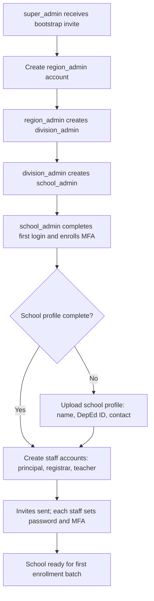
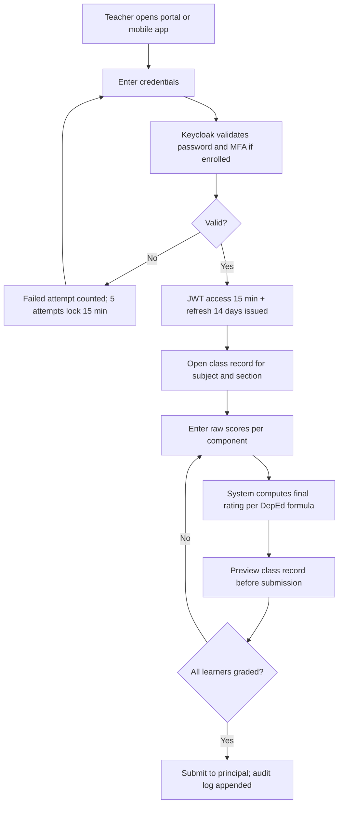
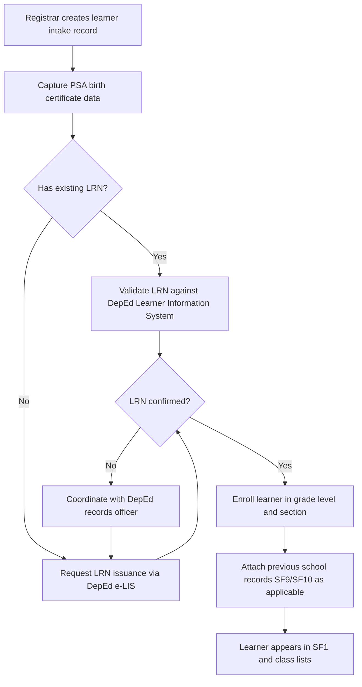
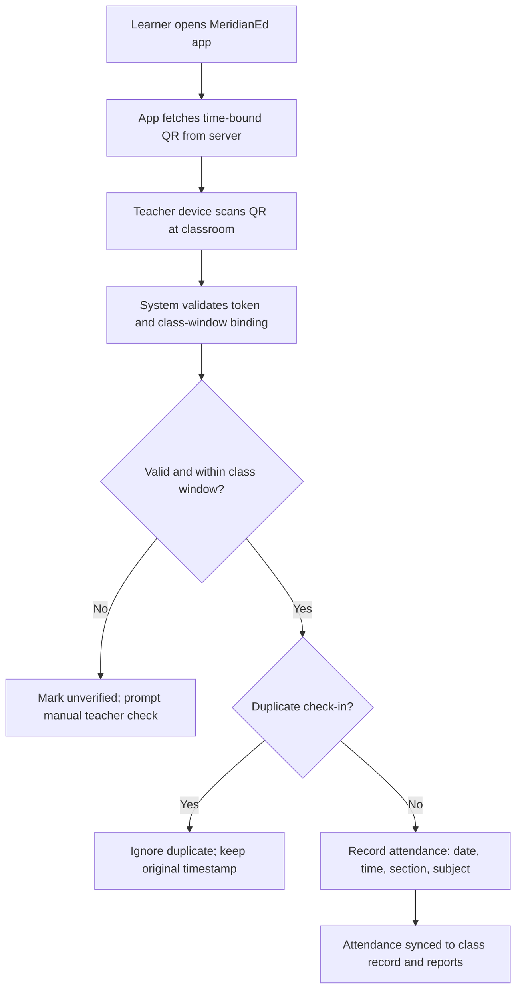
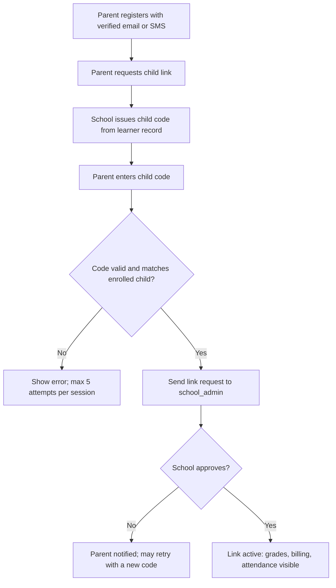
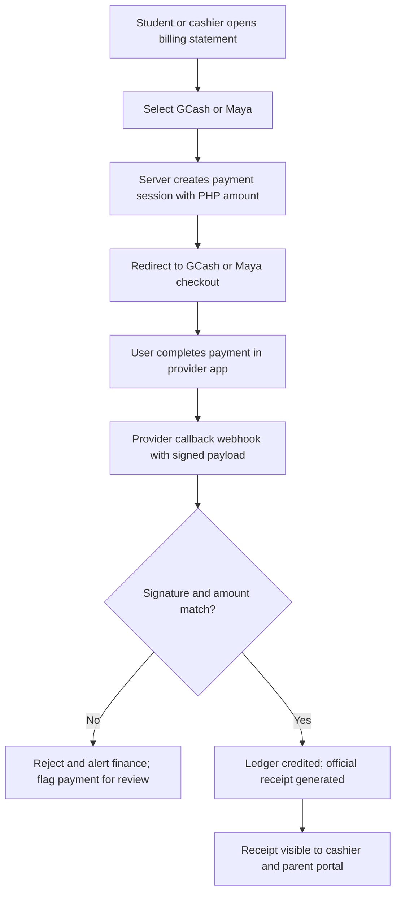
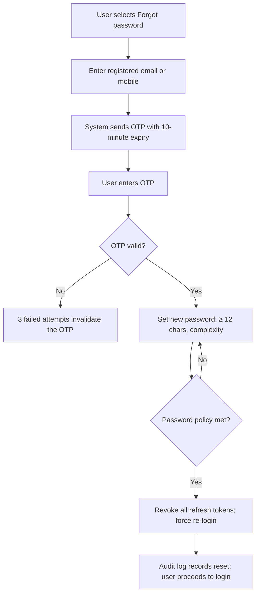
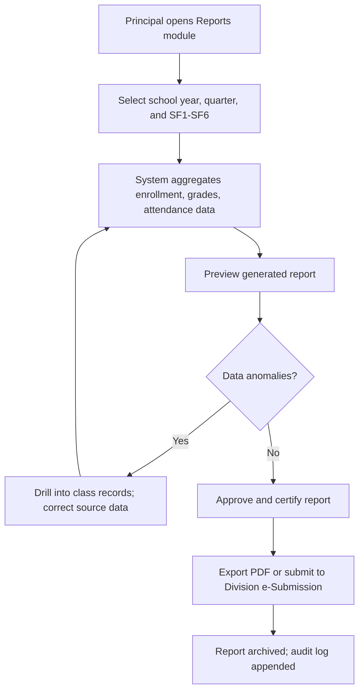

# User Flow Diagrams

MeridianEd is a secure, cloud-native, AI-powered, mobile-first school management
ecosystem that centralizes academic, administrative, financial, HR, health,
guidance, research, and operational data for elementary schools, junior/senior
high schools, colleges, universities, school divisions, and regional offices.
This deliverable documents the primary end-to-end user journeys as Mermaid
flowcharts. Flows assume production SLOs (availability 99.9%, JWT access 15 min,
refresh 14 days, password policy ≥ 12 chars) and the RBAC roles defined in the
style guide. Flows are written as vision-level; the runnable MVP implements
subsets of flows (b), (c), (g), and (h) at a smaller scale (Express + React 19 +
PostgreSQL).

> MeridianEd is a placeholder brand — the name is rebrandable at any time.

## 1. Flow conventions

| Symbol | Meaning |
|---|---|
| Rounded node | User action or system step |
| Diamond | Decision / branch point |
| Edge label (Yes/No) | Branch outcome |
| Parallel flows | Recorded in audit log at every terminal step |

All flows terminate in an append-only audit event retained 7 years (RA 10173 /
DepEd records rules). Timezone is Asia/Manila (UTC+8); money amounts are in PHP (₱).

## 2. (a) First-time admin bootstrap

A `super_admin` (platform operator) provisions the first school. The chain
region → division → school is created before any school data exists. Each
administrator completes MFA enrollment on first login.

## 3. (b) Teacher login + class record grade entry

`teacher` authenticates, opens the class record for a subject/section, enters
component scores, and submits for principal review. Grading follows DepEd
K-12 computation (written work, performance tasks, quarterly assessment).

## 4. (c) Student enrollment (DepEd LRN flow)

`registrar` validates the 12-digit LRN (`XXXXXXXXXXXX`) against DepEd e-LIS or
requests issuance, then enrolls the learner into a grade level and section.
The learner is added to SF1 and to all class lists.

## 5. (d) Attendance QR check-in

The learner's app fetches a time-bound QR; the teacher device scans it and the
system records attendance against the section's schedule. Duplicates are
discarded.

## 6. (e) Parent account linking via child code

`parent` registers, then links the child using a per-child code issued by the
school. The link is activated only after `school_admin` approval.

## 7. (f) Student billing payment via GCash/Maya

The student or `cashier` initiates payment from an assessment; the server
creates a signed payment session in PHP, redirects to GCash or Maya, and
verifies the provider callback before crediting the ledger.

## 8. (g) Password reset

Reset requires an OTP sent to registered email or mobile. On success all
refresh tokens are revoked so only the new password is valid.

## 9. (h) Principal report generation SF1–SF6

`principal` generates DepEd School Forms (SF1 enrollment, SF2 daily attendance,
SF3 books, SF4 physical inventory, SF5 report on promotions, SF6 summarized
report) from live data, reviews for anomalies, certifies, and exports.

## 10. Cross-flow security behaviors

Every flow inherits the platform security defaults:

| Behavior | Where enforced |
|---|---|
| JWT access 15 min, refresh 14 days with rotation | Flows (b), (d), (g) |
| MFA at first login for staff roles | Flows (a), (b) |
| Lockout after 5 failed attempts for 15 min | Flows (b), (g) |
| Immutable audit log, 7-year retention | All flows |
| Row-level tenant scoping (region/division/school) | All flows |
| Provider callback signature verification | Flow (f) |

---
*MeridianEd — Cloud-Based School Management Ecosystem — Deliverable 16 of 30.*
