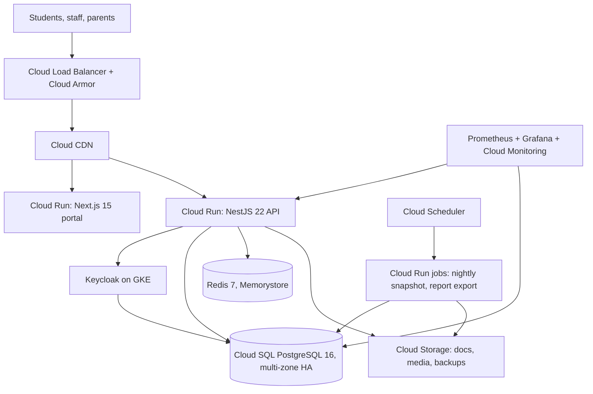

# Deployment Architecture

MeridianEd is a secure, cloud-native, AI-powered, mobile-first school management
ecosystem that centralizes academic, administrative, financial, HR, health,
guidance, research, and operational data for elementary schools, junior/senior
high schools, colleges, universities, school divisions, and regional offices.
This deliverable defines how that ecosystem is packaged, promoted, and deployed:
environments, topology (blue-green + canary), containerization, secrets,
feature flags, zero-downtime database deploys, domain/SSL, and distribution of
the web portal and Android app. The primary cloud is GCP (Cloud Run/GKE);
AWS/Azure equivalents are noted in one line where natural. The MVP runs the
same concepts via `docker-compose` (Express + React 19 + PostgreSQL) and is
not covered by the production topology below.

> MeridianEd is a placeholder brand — the name is rebrandable at any time.

## 1. Environments

| Environment | Purpose | Data | Access | Deployed via |
|---|---|---|---|---|
| dev | Developer iteration, feature work | Synthetic/seeded only, masked PII | Developers; GitHub Actions on PR | Container build + local `docker-compose` / dev Cloud Run |
| staging | Pre-production validation, e2e tests, UAT | Anonymized copy of prod (weekly) | QA, school pilot users | CI/CD on merge to `main` |
| prod | Live schools (DepEd divisions) | Production data, 99.9% availability | Staff, students, parents | CI/CD with manual approval gate |

Each environment is a separate GCP project with separate VPCs, Secret Manager
instances, and audit trails. Promotion is strictly one-way: dev → staging → prod.

## 2. Deployment topology

- Compute: Cloud Run (primary) for API and portal with 2+ minimum instances
  per service; GKE Autopilot reserved for Keycloak and long-lived batch jobs.
- Blue-green: each release is deployed as a second revision/color; traffic is
  switched only after health checks pass; instant rollback by switching back.
- Canary: 5% traffic to the new revision for 30 minutes, promoted to 50% for
  1 hour, then 100% — gated by error-rate, p95 latency, and smoke-test alerts.

### Production topology

## 3. Containerization

- Multi-stage Dockerfiles: build stage (Node 22) → runtime stage; runtime uses
  `gcr.io/distroless/nodejs22-debian12` images.
- Non-root: containers run as UID 10001; no shell, no package manager in the
  runtime image; read-only root filesystem with `/tmp` volume.
- Each image is tagged with Git SHA + semver; images are signed and scanned
  (Trivy) before registry push; only verified images may be promoted.
- Platform-agnostic note: the same images deploy to GKE/Cloud Run, AWS
  ECS/Fargate, or Azure Container Apps.

## 4. CI/CD promotion gates

| Stage | Gate | Owner |
|---|---|---|
| dev | Lint, typecheck, unit tests, container scan (Trivy, no critical CVEs), build | CI |
| staging | e2e test suite, SAST (Semgrep), dependency audit, contract tests | CI + QA |
| staging → prod | Manual approval (release manager), security sign-off | Release manager + `security` |
| prod canary | Canary thresholds: error rate < 1%, p95 < 400 ms, smoke tests pass | CI (auto-gate) |
| prod full | 100% traffic, post-deploy smoke suite, SLO watch for 24 h | SRE |

Full pipeline details, including rollback behavior, are in
[21-devops-pipeline.md](21-devops-pipeline.md).

## 5. Secrets management

- All secrets (DB credentials, JWT signing keys, Keycloak admin, GCash/Maya
  merchant keys, KMS key refs) live in Secret Manager per environment.
- Cloud Run injects secrets as environment variables or volume mounts at
  runtime; GKE uses External Secrets Operator. Secrets are never baked into
  images, committed, or logged.
- Rotation: DB credentials 90 days, JWT signing keys 30 days, provider API
  keys per provider policy. Rotation is automated and tested in staging.

## 6. Feature flags

| Flag type | Example | Lifecycle |
|---|---|---|
| Release flags | New report form, new UI | Toggled per environment; removed after GA |
| Kill switches | Payments, enrollment, reports | Always available; used for instant disable |
| Gradual rollout | AI feature cohort | Percentage-based rollout per school/division |

Flags are evaluated server-side (API) so mobile clients cannot bypass them.
Flag state is audited and stale flags are removed within one release cycle.

## 7. Zero-downtime database deploys

- Expand-contract migrations: additive changes first (new column/tables),
  dual-write window, then cutover, then drop old schema in a later release.
- Cloud SQL online DDL for safe indexes; long-running migrations run in a
  maintenance window with read replicas serving traffic.
- No destructive migrations in CI; migration plan is reviewed in
  [25-database-migrations.md](25-database-migrations.md).
- Rollback of code never requires rollback of schema.

## 8. Domain and SSL management

- Cloud DNS per environment (`meridianschools.ph` for prod, `staging.…`,
  `dev.…`); DNS records managed as Terraform, DNS security (DNSSEC) enabled.
- Managed SSL certificates at the load balancer (auto-renewed, TLS 1.3);
  HSTS preload. No self-signed certs anywhere in prod.

## 9. Android app distribution

| Channel | Purpose | Process |
|---|---|---|
| Play Console — internal testing | Dev/QA builds | 100 max users, fast iterations |
| Play Console — closed testing | Pilot schools, UAT with real devices | Review track; feedback window before production |
| Play Store production | Public release | Reviewed, staged rollout 10% → 25% → 100% |
| Direct APK | Offline/failed-store fallback | Signed APK/AAB on portal; hash + version checks; used only where Play is unavailable |

All builds are versioned with `versionCode` (monotonic) + semver `versionName`;
signing keys stored in Secret Manager/KMS-backed keystore.

## 10. Web hosting

- Portal (Next.js 15) served from Cloud Run behind Cloud CDN + Load Balancer;
  static assets cached at edge; SSR for dynamic pages with per-request auth.
- Fallback for non-GCP deployments: S3 + CloudFront or Azure Front Door
  equivalents.

---
*MeridianEd — Cloud-Based School Management Ecosystem — Deliverable 18 of 30.*
