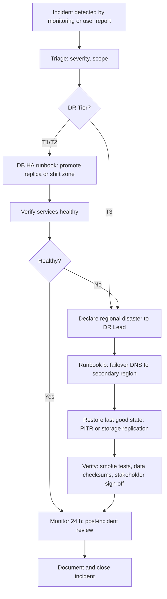

# Disaster Recovery Plan

MeridianEd is a secure, cloud-native, AI-powered, mobile-first school management
ecosystem that centralizes academic, administrative, financial, HR, health,
guidance, research, and operational data for elementary schools, junior/senior
high schools, colleges, universities, school divisions, and regional offices.
This deliverable is the disaster recovery (DR) plan for that ecosystem: RPO/RTO
targets, DR tiers, secondary-region strategy, failover workflow, runbooks for
the three primary failure classes, communication, RACI, testing schedule, and
post-incident review. It depends on the backup strategy in
[19-backup-strategy.md](19-backup-strategy.md) and the security controls in
[17-security-architecture.md](17-security-architecture.md). Primary cloud is
GCP (Cloud SQL, Cloud Storage, Cloud DNS); equivalents noted where natural.

> MeridianEd is a placeholder brand — the name is rebrandable at any time.

## 1. Recovery targets

| Metric | Target | Notes |
|---|---|---|
| Availability | 99.9% | Multi-zone, no single point of failure |
| RPO | ≤ 15 minutes | Continuous WAL archiving + nightly snapshots |
| RTO — DB HA | ≤ 15 minutes | Zone-level replica promotion |
| RTO — region failover | ≤ 4 hours | Declared via runbook (b) |
| RTO — service tier (portal/API) | ≤ 30 minutes | Redeploy from registry |
| RTO — object storage | ≤ 1 hour | Multi-region replication + versioning |

## 2. DR tiers

| Tier | Failure scope | Data loss | RTO | Trigger |
|---|---|---|---|---|
| T1 | Single DB instance | RPO ≤ 15 min | ≤ 15 min | Instance unhealthy, replica promotion |
| T2 | Single zone (asia-southeast1-a) | RPO ≤ 15 min | ≤ 30 min | Zone outage; shift to other zones |
| T3 | Full region (asia-southeast1) | RPO ≤ 15 min (last replicated WAL), ≤ 1 h worst case | ≤ 4 h | Region outage; secondary region failover |

Declaring a tier is a DR Lead decision; escalation follows the communication
plan (Section 5).

## 3. Secondary region strategy

- Primary region: `asia-southeast1` (Singapore) for latency to Philippines;
  secondary region: `asia-east1` (Taiwan) with asynchronous DB replication
  and multi-region storage (dual-region buckets).
- Cloud SQL cross-region replica is read-only in steady state; promotion
  requires the runbook in Section 4b. Asynchronous replication means up to the
  RPO window of data may be lost — accepted per targets.
- Cloud DNS failover: DNS records with health-checked traffic steering;
  failover flips the front-end IP to the secondary region's load balancer.
  Manual confirmation required; no automatic failover that could cause
  split-brain writes.
- Storage: multi-region replication of business buckets; media and audit logs
  readable from either region.

## 4. DR workflow

## 5. Runbooks

### (a) DB instance failure (Tier 1)

1. Confirm failure via alert (DB down, replicas lagging) — page DB admin.
2. If primary unhealthy, promote the most recent synchronous replica
   (zones remain available).
3. Point API config to new primary (no code change; connection string in
   Secret Manager per environment is rotated).
4. Verify WAL lag at cutover ≤ RPO; accept documented loss window.
5. Run smoke tests: login, learner lookup, grade read/write, attendance.
6. Keep old primary quiesced for forensics; do not rejoin automatically.
7. Repair or recreate original instance; fail back during next maintenance
   window.

### (b) Full region outage (Tier 3)

1. DR Lead declares regional disaster; communication plan activated.
2. Promote cross-region replica to primary in `asia-east1` (PITR to last
   consistent point; RPO ≤ 15 min).
3. Re-point DNS (health-checked traffic steering) to secondary LB; confirm
   portal and API reachable; keep Cloud Armor WAF rules in force.
4. Enable read/write in secondary; verify Keycloak realm restored from backup
   if auth is degraded.
5. Run restore verification: object checksums, audit log continuity, sample
   SF1–SF6 report generation.
6. Notify affected divisions; give ETA via communication channels (Section 5).
7. Remain in secondary for up to 72 h; then plan controlled failback.

### (c) Ransomware / data corruption

1. Treat as security incident: `security` owns; isolate infected systems and
   revoke suspected credentials immediately.
2. Confirm corruption scope from backup chain metadata (last good full +
   WAL).
3. Restore last good PITR point into an isolated test project; validate data
   integrity before production restore.
4. Restore to production; re-apply immutable audit log from WORM storage.
5. Do not pay ransom; preserve forensic copies of encrypted data per DPA.
6. If DPA breach confirmed: NPC + data-subject notification within 72 h
   (see [17-security-architecture.md](17-security-architecture.md)).
7. Post-incident: root-cause, backup-chain hardening, access review.

## 6. Communication plan

| Audience | Channel | Timing | Message owner |
|---|---|---|---|
| DR team | Incident channel + call bridge | Immediate | DR Lead |
| Executive / school divisions | Email + division portal notice | Within 1 h of T3 | Executive sponsor |
| ICT of affected schools | Email + SMS | Within 2 h | DR Lead |
| Teachers/students/parents | Portal banner + app notice | Within 4 h | Communications |
| Regulators (NPC) | Formal notification | Within 72 h if breach | DPO |
| Public | Post (if required by law) | As determined | Executive sponsor |

## 7. DR team RACI

R = responsible, A = accountable, C = consulted, I = informed.

| Activity | DR Lead | DB Admin | App/Platform | Network/Infra | Security/DPO | Comms | Division Liaison |
|---|---|---|---|---|---|---|---|
| Detect and triage | A | R | R | C | C | I | I |
| Declare tier / disaster | A | C | C | C | C | I | I |
| DB failover / restore | A | R | C | C | I | I | I |
| DNS / LB failover | A | I | C | R | I | I | I |
| App re-deploy / smoke tests | A | I | R | C | I | I | I |
| Breach assessment (T3c) | C | C | C | C | A/R | C | I |
| Stakeholder notification | C | I | I | I | C | R | R |
| Post-incident review | A | R | R | R | R | C | C |

## 8. Annual DR test schedule

| Month | Exercise | Type | Success criteria |
|---|---|---|---|
| Jan | T1 DB failover | Live drill, staging | RTO ≤ 15 min |
| Apr | T3 regional failover | Full simulation, staging + prod read-only | RTO ≤ 4 h, RPO ≤ 15 min |
| Jul | T3c ransomware restore | Tabletop + restore drill | Restore verified, notifications rehearsed |
| Oct | Zone failover + communications | Live drill + comms test | Zone shift < 30 min; comms within 2 h |

Each exercise is announced to on-call staff; no surprise failovers in prod.
Results are reviewed within 5 business days and corrective actions tracked.

## 9. Post-incident review

1. Timeline reconstruction from audit logs and monitoring.
2. Measure actual RPO/RTO against targets; record deviations.
3. Root-cause analysis; classify as infrastructure, process, or security.
4. Corrective actions with owners and due dates (30-day default SLA).
5. Update runbooks and DR test schedule; share summary with DR team.

---
*MeridianEd — Cloud-Based School Management Ecosystem — Deliverable 20 of 30.*
