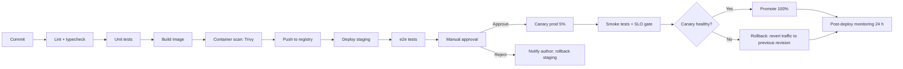

# DevOps Pipeline

MeridianEd is a secure, cloud-native, AI-powered, mobile-first school management
ecosystem that centralizes academic, administrative, financial, HR, health,
guidance, research, and operational data for elementary schools, junior/senior
high schools, colleges, universities, school divisions, and regional offices.
This deliverable defines the continuous delivery pipeline for that ecosystem:
CI/CD flow, GitHub Actions structure, quality gates, infrastructure as code,
environment promotion, monitoring/alerting, release versioning, and incident
management. It operates the deployment architecture in
[18-deployment-architecture.md](18-deployment-architecture.md) and upholds the
SLOs in [04-non-functional-requirements.md](04-non-functional-requirements.md):
99.9% availability, RPO ≤ 15 min, RTO ≤ 4 h. The MVP pipeline is a reduced
subset (lint → test → build → compose deploy) of the production flow below.

> MeridianEd is a placeholder brand — the name is rebrandable at any time.

## 1. Pipeline overview



## 2. GitHub Actions workflow

| Job | Trigger | Steps | Caching / matrix |
|---|---|---|---|
| `lint` | PR, push to `main` | ESLint, Prettier, `tsc --noEmit` | pnpm cache (hash of lockfile) |
| `test` | PR, push | Unit + integration tests | Matrix: Node 22 LTS; PostgreSQL 16 container |
| `build` | push to `main`, release tag | Next.js + NestJS builds, SBOM generation | Build cache; layer cache for Docker |
| `scan` | after `build` | Trivy (image), npm audit, Semgrep SAST, ZAP DAST (staging) | Trivy cache/db |
| `deploy-staging` | merge to `main` | Terraform apply (staging), Cloud Run deploy | State via tfstate bucket |
| `e2e` | after staging deploy | Playwright/Cypress suite on staging URL | Test artifacts uploaded |
| `release` | manual trigger (tag `vX.Y.Z`) | Approval gate → canary prod → smoke → promote | Version derived from tag |

- Concurrency: per-environment serialization (a `deploy` group prevents
  parallel prod deploys). PRs run lint/test/scan only; `main` runs the full
  chain; release tags require the manual approval job.
- Caching: pnpm store, Docker layer cache, Trivy DB; all keys versioned so
  cache invalidation is deterministic.
- Secrets: all workflow secrets from GitHub Environments (dev/staging/prod),
  never inline; OIDC federation to GCP (no long-lived service-account keys).

## 3. Quality gates

| Gate | Tool | Threshold | Enforced at |
|---|---|---|---|
| Unit test coverage | Jest/Vitest | ≥ 80% statements | PR, `main` |
| Lint/typecheck | ESLint, tsc | Zero errors | PR, `main` |
| SAST | Semgrep | No high/critical findings | PR, `main` |
| Container scan | Trivy | No critical CVEs; high with approval | `build`/`scan` |
| Dependency audit | npm audit / Dependabot | No high/critical | Weekly + PR |
| DAST | ZAP baseline | No high findings on staging | Weekly + staging deploy |
| e2e suite | Playwright/Cypress | 100% pass | Staging |
| License check | license-checker | Allow-list only | `scan` |

Any gate failure blocks promotion to the next stage; no waivers in prod.

## 4. Infrastructure as code

- Terraform (HCP or GCS backend with state versioning), layout:

```
terraform/
├── modules/          # vpc, dns, sql, storage, cloudrun, keycloak
├── environments/
│   ├── dev/          # main.tf, backend.tf, variables.tf
│   ├── staging/
│   └── prod/         # restricted apply (human-only)
└── locals.tf
```

- Drift detection: scheduled `terraform plan` every 6 h per environment; drift
  alerts page the platform team. Manual `apply` in prod requires two-person
  approval via PR to the repo.
- All resources tagged (`env`, `owner`, `cost-center`); unused resources
  auto-flagged weekly.

## 5. Environment promotion

Dev → staging → prod, one-way. Promotion is only via the pipeline; no manual
deploys to prod. Prod deploys run canary (5% → 50% → 100%) with auto-rollback
on gate failure, per [18-deployment-architecture.md](18-deployment-architecture.md).

## 6. Monitoring and alerting

- Stack: Prometheus + Grafana, Cloud Monitoring/Logging, Sentry for app errors,
  ELK for audit/ops logs.
- Dashboards: API error rate, p95/p99 latency, DB connections + replication
  lag, queue depth, Redis hit rate, deploy frequency, backup status, SLO
  burn-rate.

| Alert rule | Threshold | Severity | Escalation |
|---|---|---|---|
| Error rate | > 1% over 5 min | Critical | Page SRE on-call |
| p95 latency | > 400 ms over 10 min | Warning | Page SRE on-call |
| DB CPU / connections | > 80% / 90% | Warning | Page DB on-call |
| Replication lag | > 15 min | Critical | Page DB on-call |
| Backup failure | any | Critical | Page DB on-call |
| Disk / storage usage | > 85% | Warning | Page platform |
| SLO burn | > 2% of 30-day budget in 1 h | Critical | Page SRE + DR Lead |
| Canary gate fail | any | Critical | Auto-rollback + page |

- On-call rotation: weekly, two tiers (SRE primary, DB/platform secondary),
  Asia/Manila business hours with 24/7 page path; follow-the-sun handoff for
  out-of-hours. Escalation: on-call → SRE lead → CTO (T3 incidents).

## 7. Release process and versioning

- SemVer: `MAJOR.MINOR.PATCH` from tags; `versionCode` for Android derives
  from build number. Conventional Commits drive an auto-generated changelog
  (release-drafter); changelog includes breaking changes, features, fixes,
  and migration notes.
- Release cadence: weekly patches, bi-weekly features, monthly minor; hotfix
  path is branch from tag → full pipeline → canary.
- Every release records: commit range, artifacts (image digests, AAB hash),
  deploy timestamps, gate evidence, and rollback revision.

## 8. Incident management

| Severity | Impact | Response time | Owner |
|---|---|---|---|
| SEV1 | Platform down / data breach | ≤ 15 min | SRE lead + DR Lead |
| SEV2 | Major feature degraded | ≤ 30 min | On-call |
| SEV3 | Minor issue, workaround exists | ≤ 4 h | Team |
| SEV4 | Cosmetic / backlog | Next sprint | Team |

Flow: detect (alert/user report) → triage → mitigate (rollback, feature flag
kill switch) → fix forward → post-incident review within 5 business days.
SEV1/SEV2 incidents follow the DR communication plan in
[20-disaster-recovery.md](20-disaster-recovery.md); all incidents create
timeline records in the audit log. Postmortems are blameless and published to
the team with corrective actions tracked to closure.

---
*MeridianEd — Cloud-Based School Management Ecosystem — Deliverable 21 of 30.*
