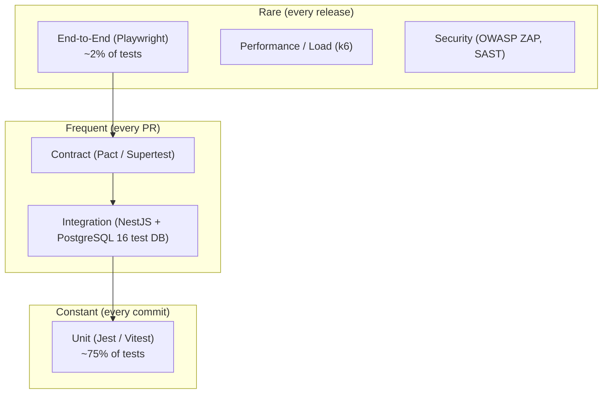

# Testing Strategy

MeridianEd is a secure, cloud-native, AI-powered, mobile-first school management
ecosystem that centralizes academic, administrative, financial, HR, health,
guidance, research, and operational data for elementary schools, junior/senior
high schools, colleges, universities, school divisions, and regional offices.
This document defines how that platform is tested: the test pyramid, tooling,
coverage targets, module-specific test scenarios, test data strategy, CI
integration, UAT with a real DepEd pilot school, regression strategy, and defect
management. It is the contract for all quality assurance work in the target
architecture (Next.js 15 + TypeScript web, Flutter 3 mobile, NestJS API,
PostgreSQL 16, GCP).

> MeridianEd is a placeholder brand — the name is rebrandable at any time.

> **MVP note:** the runnable MVP (React 19 + Vite web portal, Express backend,
> PostgreSQL with `node:sqlite` fallback, Capacitor 8 Android wrapper) must
> implement the mandatory items marked MUST below at reduced scale. Vision-level
> items are marked as "target architecture".

## 1. Quality objectives

| Objective | Target |
|---|---|
| Production availability | 99.9% (no release may regress this SLO) |
| Critical defect escape rate | ≤ 1 per release train |
| Test execution time in CI | ≤ 15 minutes (fast feedback) |
| Coverage (unit, core domain) | ≥ 80% lines / ≥ 70% branches |
| Coverage (integration) | ≥ 60% of API contract paths |
| E2E critical journeys | 100% green before any production release |
| Accessibility | WCAG 2.1 AA on all public and staff screens |

Testing MUST be treated as part of the definition of done: no user story ships
without its tests. Quality gates are enforced in CI, not by review opinion.

## 2. Test pyramid

The pyramid is deliberately wide at the bottom: most assertions live in fast
unit tests, fewer in integration tests, and a small number of slow end-to-end
tests protect critical user journeys. Contract, security, and performance tests
run on dedicated triggers.



| Layer | Share of suite | Speed target | Fail-fast gate |
|---|---|---|---|
| Unit | ~75% | ms per test | Commit / PR |
| Integration | ~20% | seconds | PR |
| Contract | ~2% | seconds | PR |
| E2E | ~2% | minutes | PR (smoke) / nightly (full) |
| Perf / load / security | ~1% | minutes to hours | Nightly / release |

## 3. Test levels and tooling

| Level | Tool | Scope | Cadence | Owner |
|---|---|---|---|---|
| Unit | Jest (NestJS), Vitest (Next.js), Flutter `flutter test` | Domain logic, pure functions, components, widgets | Every commit | Developers |
| Integration | Supertest + Jest, Testcontainers (PostgreSQL 16), `node-pg-migrate` fixtures | API + DB, module boundaries, async workers | Every PR | Developers |
| Contract | Supertest snapshots → Pact (later); OpenAPI 3 validation | API contract stability, mobile ↔ API | Every PR | API team |
| E2E | Playwright (web), Flutter integration_test (mobile), Maestro (Android smoke) | Critical journeys across UI + API + DB | PR smoke + nightly full | QA |
| Performance | k6 (Grafana) | API/DB under load, soak, spike | Nightly, release, quarterly | SRE |
| Security | OWASP ZAP, Semgrep/ESLint security, `npm audit`, Trivy (containers), Keycloak SSO tests | OWASP Top 10, dependency CVEs, auth flows | Every PR (SAST) + nightly (ZAP DAST) | Security |
| Accessibility | axe-core (Playwright + axe), `flutter analyze` + semantic checks, manual screen-reader pass | WCAG 2.1 AA | Nightly + release | QA |
| Visual regression | Playwright screenshots, Chromatic (optional) | UI drift, mobile breakpoints | Nightly | QA |
| Mobile offline | Flutter integration_test with network-condition simulation (Netem, Android emulator offline toggle) | Sync queue, conflict resolution | Nightly | Mobile team |
| Load | k6 + PgBouncer + replica pool | Capacity targets per §11 | Quarterly + pre-events (e.g., enrollment surge) | SRE |

## 4. Coverage targets

| Unit | Module | Minimum line coverage |
|---|---|---|
| U1 | Grades computation engine (weighting, transmutation, general average) | 95% |
| U2 | Attendance rules (absences, tardiness, holidays, suspensions) | 90% |
| U3 | RBAC / authorization matrix | 100% (matrix-driven) |
| U4 | Offline sync conflict resolution | 90% |
| U5 | Finance computations (tuition, payments, BERF-adjacent funds ledger) | 90% |
| U6 | Report generation (SF1–SF6 mapping, LRN formatting) | 90% |
| U7 | Utility/validation (LRN checksum, date handling in Asia/Manila) | 85% |
| U8 | Web UI components, mobile widgets | 70% |
| U9 | General application code | 80% |

Coverage is tracked per-package in CI (`jest --coverage`, `vitest
--coverage`); merges that lower a module below its floor are blocked. Branch
coverage on the grades engine MUST be ≥ 70%.

## 5. What to test per module

### 5.1 Grades computation correctness

DepEd K-12 grading (DepEd Order 8, s. 2015) combines Written Work, Performance
Tasks, and Quarterly Assessment with weights that differ by level; final grades
are transmuted to a 60–100 scale and rounded per DepEd rules. Tests MUST cover:

| Scenario | Expected behavior |
|---|---|
| JHS weights (WW 40% / PT 40% / QA 20%) vs SHS Academic (25/45/30) vs TVL variants | Correct weighted raw score |
| Transmutation table boundaries (e.g., 100→100, 74.99 vs 75 thresholds) | Correct transmuted grade, no off-by-one |
| General average across subjects, rounding of component and final grades | DepEd-specified rounding (1 decimal, .50 rule per policy) |
| Incomplete grades (INC), dropped subjects, honors eligibility (≥ 90) | Correct flags, no exclusion errors |
| Grade changes with audit trail | Re-computation consistency, immutable history |
| Failed mark → remediation/ARAL mapping | Correct linkage |
| Quarter rollover, final rating for report card (SF9) | Identical to validated SF9 output |

### 5.2 Attendance edge cases

| Scenario | Expected behavior |
|---|---|
| Regular day: present, late, absent, half-day, early dismissal | Correct daily record and totals |
| Holiday/DepEd-declared suspension (typhoon, elections) | No absence counted, class days adjusted |
| Make-up classes / Saturday classes | Counted correctly |
| Student transfers mid-period | Attendance splits by school correctly |
| Offline capture on mobile, synced hours later | Queue replayed in order, no double count |
| Midnight rollover (Asia/Manila), end-of-school-year cutoff | Correct period attribution |
| Absences → 20-day limit flag for grading/retention policy | Flag triggers only at exact threshold |

### 5.3 RBAC matrix tests

Tests MUST be generated from the role matrix (16 roles × modules, region →
division → school → section scoping). Every endpoint and screen asserts the
actor's tree node: a `division_admin` MUST never read another division's data;
a `teacher` MUST only write their own sections. Matrix tests run as a dedicated
suite that iterates (role, action, module, tenant-scope) tuples and asserts
HTTP 200/403/404 outcomes, including negative cases and cross-tenant probing.
Row-level tenant scoping failures are treated as P0 security defects.

### 5.4 Offline sync conflict resolution

The Flutter app queues writes while offline. Tests MUST verify:

| Scenario | Expected behavior |
|---|---|
| Same record edited offline and online (last-write-wins with server timestamp tie-break) | Deterministic winner, loser preserved in conflict log |
| Attendance batch upload races with server-side section change | Conflict logged, reviewer queue entry created |
| LRN/student created offline duplicates an online record | Merge on LRN match, no orphan records |
| Sync resumption after network drop mid-batch | Idempotent replay, no duplicates |
| Large offline queue (e.g., 500 attendance rows) | Ordered replay within 60 s, progress visible |
| Concurrent sync from two devices | Optimistic locking via `updated_at`/version column |

### 5.5 Other modules (brief matrix)

| Module | Must-test scenarios |
|---|---|
| SIS / enrollment | LRN validation (12-digit), grade-level placement, school year (SY) rollover |
| Finance | Invoice/payment math in PHP, refunds, cashier closing balance, arrear computation |
| Reports | SF1–SF6 column mapping matches DepEd template; output equals report-card data |
| Teacher management | Load assignment, section-to-teacher mapping, DLL submission workflow |
| Library / clinic / guidance / property | Item loans, medicine log, referral workflow, property depreciation (if any) |
| Communication | Notification delivery (in-app/email/SMS fallback), broadcast scoping by tree node |
| System admin | User lifecycle, password policy (12+ chars, 90-day expiry, lockout), audit log append-only |

## 6. Test data strategy

| Concern | Policy |
|---|---|
| Generation | Synthetic generators produce LRNs (12-digit, valid checksums), Filipino and regional names, subjects, sections, schools, divisions/regions |
| PII | Real DepEd learner data NEVER enters CI. Production-like data is generated or derived from anonymized pilot aggregates only (RA 10173 purpose limitation) |
| Golden datasets | Frozen, versioned datasets for grades, SF reports, and finance (one "golden" set per SY) so regressions are reproducible |
| Per-test isolation | Each test run uses a fresh PostgreSQL 16 schema; migrations applied via the migration plan; tests never share mutable state |
| Seeding | A deterministic seed (fixed RNG seed) for unit tests; realistic volume data (`factory` scripts) for load/staging |
| Staging mirror | Staging carries synthetic data sized ~1 division; optionally a DPAct-compliant anonymized snapshot of pilot data |
| Retention | Test databases are ephemeral (destroyed after CI); anonymization verified by `presidio`-style scrubbers or equivalent checks |

## 7. CI integration

Quality gates execute in GitHub Actions in the order below. Failure at any gate
blocks the pipeline.

```mermaid
flowchart LR
    A[Push / PR] --> B[Lint + typecheck<br/>ESLint, tsc, prettier]
    B --> C[Unit tests<br/>Jest / Vitest / flutter test]
    C --> D[Coverage floor check]
    D --> E[Integration<br/>Testcontainers + PG 16]
    E --> F[Contract + OpenAPI validation]
    F --> G[SAST: Semgrep, npm audit, Trivy]
    G --> H[E2E smoke (Playwright)<br/>+ axe a11y on key routes]
    H --> I[Build + push images]
    I --> J[Deploy to staging]
    J --> K[Nightly: full E2E, ZAP DAST, k6, visual regressions]
    K --> L[Release candidate review]
```

- PR pipeline MUST complete in ≤ 15 minutes; slow suites move to nightly.
- Flaky tests are quarantined with an owner and a 48-hour fix deadline; they do
  not block CI while quarantined but MUST return or be deleted.
- Every release candidate runs the full nightly suite plus a ZAP active scan on
  the staging tenant.

## 8. UAT with a real DepEd pilot school

| Aspect | Plan |
|---|---|
| Pilot scope | 1–2 schools in one division (SY 2026–2027); ~500 learners, 25 teachers, 1 principal, 1 registrar, 1 guidance counselor |
| Participation | School head, registrar, teachers from each grade band; Division Office ICT + curriculum staff as observers |
| Preparation | 2-week onboarding, role-specific training, sandbox with synthetic data, then go-live with anonymized historical records |
| Validation focus | SF1–SF6 output matches school's existing DepEd templates; grades computation matches the registrar's manual recomputation for a sample of 10 learners |
| Collection | Structured scenario checklist + "UAT defect" tag in the tracker; daily triage during the 2-week window; weekly debrief with school head |
| Exit criteria | All P0/P1 UAT defects closed; 100% of scenario checklist items signed off; school head and Division ICT approval in writing |
| Follow-on | Pilot becomes the reference tenant for regression "golden runs"; UAT repeats at every major release with the pilot school (remote) |

## 9. Regression strategy

| Layer | Approach |
|---|---|
| Unit/integration | Full suite on every PR; golden datasets guard grades, reports, finance |
| E2E | Nightly full journey suite; critical journeys (login → attendance → grade entry → report card) run as smoke on every PR |
| Regression window | Fixed 5-day window before each scheduled release; automation first, manual exploratory for changed modules only |
| Cross-version | DB migrations tested forward-only; `rollback` verified in staging, not production |
| Data-level | Re-run of monthly snapshot through report pipelines to detect silent data drift |
| Mobile | OS matrix (Android 9+, iOS, tablet, Chromebook) nightly on emulators; quarterly real-device farm pass |
| Performance | Baseline k6 profiles stored; any regression > 10% on p95 latency blocks release |
| Security | ZAP baseline on every staging deploy; full active scan monthly |

## 10. Defect management

Defects are logged in the tracker with severity (business impact) and priority
(delivery urgency) assigned independently. Severity and priority are set by the
tester; only a lead can downgrade.

| Level | Definition | Example |
|---|---|---|
| Severity 1 — Critical | Blocks use, corrupts data, security/DPA breach, wrong grades or money | Grade miscalculation, cross-tenant data leak, audit log tampering |
| Severity 2 — Major | Main feature unusable with workaround | Report card export fails for one level |
| Severity 3 — Minor | Cosmetic, edge case, low-impact | Label misalignment on mobile |
| Severity 4 — Trivial | Polish | Typo in empty-state text |

| Priority | SLA | Handling |
|---|---|---|
| P0 — Blocker | Acknowledge 1 h; fix ≤ 24 h | Hotfix path, incident call, release train halted |
| P1 — Urgent | Acknowledge 1 business day; fix ≤ 5 business days | Included in next patch release |
| P2 — Normal | Fix ≤ next release | Scheduled backlog |
| P3 — Low | Triaged quarterly | Backlog, may be closed as won't-fix with QA sign-off |

Defect lifecycle: New → Triaged → In Progress → Fixed → Re-tested →
Closed (verification on the fix build; regression test added). Every fixed
defect MUST include a regression test. A weekly QA review tracks defect age,
escapes (defects found in production that tests missed), and quarantined flakes;
escape root causes feed back into §7 test additions.

---

*MeridianEd — Cloud-Based School Management Ecosystem — Deliverable 26 of 30.*
