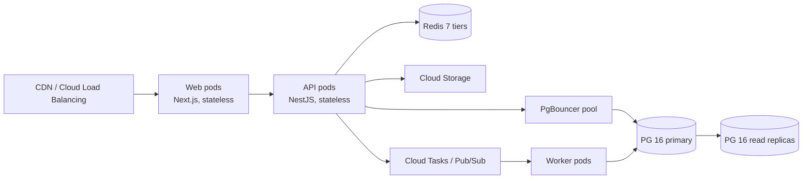

# Scalability Plan

MeridianEd is a secure, cloud-native, AI-powered, mobile-first school management
ecosystem that centralizes academic, administrative, financial, HR, health,
guidance, research, and operational data for elementary schools, junior/senior
high schools, colleges, universities, school divisions, and regional offices.
This plan defines how the target architecture (Next.js 15 + TypeScript,
NestJS API, PostgreSQL 16, Redis 7, Flutter 3, GCP) scales from a single pilot
school to 1M+ learners across the Philippines — the scaling model per layer,
vertical-to-horizontal path, microservices extraction roadmap, caching strategy,
sharding plan, database optimization, capacity planning, and load testing
targets.

> MeridianEd is a placeholder brand — the name is rebrandable at any time.

> **MVP note:** the runnable MVP is a single-instance deployment (one container,
> one PostgreSQL database) that MUST still use parameterized queries, immutable
> uploads to Cloud Storage, and stateless server code so it can scale by
> horizontal duplication without rework. Everything in §2–§8 is "target
> architecture".

## 1. Design principles

| Principle | Meaning |
|---|---|
| Stateless everything | Any server instance is disposable; state lives in PostgreSQL 16, Redis 7, Cloud Storage, or Pub/Sub |
| Scale by duplication first | Duplicate the running service; split it into services only when a clear trigger fires (§4) |
| Tenant-scoped by tree | Region → division → school scoping makes region/division the natural shard key |
| Data locality | Requests are routed to the nearest region replicas (Asia/Manila primary, CDN everywhere) |
| Demand-shaped by the school calendar | Peak traffic follows the DepEd SY: enrollment (May–June), grading periods, exam weeks (Oct/Dec/Mar), end of SY |
| Capacity is a budget | Every feature states its incremental resource cost per school/user before it ships |

## 2. Capacity planning targets

| Dimension | Pilot (SY 2026–27) | Division (2027) | Region (2028) | Full PH (2030) |
|---|---|---|---|---|
| Learners | 500 | 200,000 | 1,000,000 | 3,000,000+ |
| Schools | 2 | 300 | 1,500 | 30,000+ |
| Staff users | 40 | 8,000 | 45,000 | 150,000 |
| Parent/student app users | 600 | 150,000 | 800,000 | 2,500,000 |
| Peak concurrent users | 100 | 6,000 | 25,000 | 100,000 |
| Peak API RPS | 20 | 800 | 3,500 | 15,000 |
| Write-heavy peaks | Grade entry week | 3× daily | 3× daily | 3× daily |
| Active rows (core tables) | 10M | 400M | 2B | 6B+ (sharded) |
| Object storage (attachments, SF exports) | 50 GB | 20 TB | 100 TB | 400 TB |

Computed with per-school baselines: ~1,800 learners/school, ~20 writes/school/s
at grade-entry peak, ~4 KB average payload, 7-year audit retention (immutable).

## 3. Scaling model per layer

| Layer | Component | Scaling approach | Trigger to scale | Practical ceiling |
|---|---|---|---|---|
| Web frontend | Next.js 15 on Cloud Run / GKE (stateless, containerized) | Horizontal autoscaling by CPU/concurrency; CDN + edge caching for public pages; ISR for dashboards | > 70% CPU sustained 5 min, or > 1,000 concurrent sessions per pod | Effectively unlimited (100s of pods) |
| Mobile | Flutter app + offline queue | Client-side; no server scaling (offline-first absorbs most read traffic) | N/A | N/A |
| API | NestJS on Cloud Run/GKE | Horizontal autoscale; connection pooling via PgBouncer; idempotency keys for writes | > 60% CPU, p95 latency > 500 ms, queue depth | Unlimited (target 100k concurrent) |
| Database | PostgreSQL 16 (Cloud SQL, multi-zone HA primary) + read replicas | 1 primary + N read replicas (start 2, add per load test); PgBouncer in transaction pooling mode | Read: replica CPU > 70%; write: primary CPU > 60% | Writes on primary until sharding (§6) |
| Cache | Redis 7 (Memorystore) | Cache tiers §5; cluster mode ≥ 100 GB scale | Memory > 70%, evictions > 1% | Tiers can be split per region |
| Object storage | Cloud Storage | Effectively infinite; lifecycle rules to coldline/archive | Cost policy, not capacity | Lifecycle-managed |
| Async workers | Cloud Tasks / Pub/Sub → GKE worker pool | Queue depth autoscale (grading, report gen, notification fan-out) | Queue depth > 10,000 or lag > 60 s | Unlimited |
| Search | PostgreSQL FTS → (later) Elasticsearch/OpenSearch | Follows DB replicas; dedicated index shards by region later | Query p95 > 200 ms | Region-level clusters |
| Auth | Keycloak (OIDC) cluster | Horizontal; sessions in Redis | > 60% CPU | Region-local realm replicas |

### 3.1 Request path with scaling

## 4. Vertical-to-horizontal path

| Phase | Action | When |
|---|---|---|
| V1 | Larger machine sizes (2 → 8 vCPU), more memory; no architectural change | Pilot; ≤ 2,000 schools |
| H1 | Stateless duplicate: 2+ pods behind LB, PgBouncer, read replicas, Redis for sessions/cache | Division rollout (SY 2027–28) |
| H2 | Queue-based async: all report generation, grade aggregation, notifications move to workers | Before 100 schools |
| H3 | Read replicas per region + regional caches; API autoscale by queue depth and latency SLO | Region-level (2028) |
| H4 | Shard PostgreSQL by region/division (§6); hot partitions split per school_year | At ≥ 1M learners or when primary write CPU > 60% |
| H5 | Extract services (§5) with dedicated pools | Per trigger, not by calendar |

Rule: the platform MUST run the vertical phase and every horizontal phase without
data migration — schema and shard key are designed up front so data placement is
the only thing that changes.

## 5. Microservices extraction roadmap

The default is a modular monolith (NestJS modules) with hard module boundaries
and isolated schemas. Extract to a separate deployment ONLY when a trigger fires.

| Candidate service | Extraction triggers | Earliest window | Notes |
|---|---|---|---|
| Payments (Finance) | Two teams needing it; PCI-adjacent isolation; different release cadence; regulator asks | After division rollout (2027) | Ledger in its own schema first; service only for PSP adapters (GCash, Maya, BPI, PayMongo) |
| Notifications (Communication) | Fan-out volume > 100k msgs/day; SMS/email provider churn | 2028 | Pub/Sub-driven; idempotent providers; retry + dead-letter |
| AI features (per 29-ai-roadmap) | GPU/serving infra differs from CPU API; long-running inference | P1 AI (2028) | Separate worker pool and model gateway; never in request path |
| Reports / SF exports | PDF generation CPU bursts; queue latency pressure | 2027 if needed | Worker-side, not an API service |
| Search & analytics | Dedicated index/replica divergence; BI dashboards on OLAP workloads | 2028 | Analytics reads from replicas/BigQuery export, never primary |

Shared contract: every service communicates via REST/GraphQL gateway + events;
there is a single source of truth per entity (e.g., student record lives in the
SIS module, referenced elsewhere by ID).

## 6. Caching strategy

| Cache tier | What | Where | TTL | Invalidation |
|---|---|---|---|---|
| L1 — Edge/CDN | Public assets, static pages, subject catalogs | Cloud CDN | Long / until content release | Cache-busting hashes |
| L2 — Web (ISR/ISR-tagged) | School public pages, dashboard shells, lookup lists | Next.js ISR / server cache | 60 s–24 h | Tag-based revalidation on data change |
| L3 — API (Redis) | Lookups: sections, subjects, teachers, class schedules, LRN→student, division/region tree | Redis 7 | 5 min–24 h | Event-driven delete on writes (cache-aside) |
| L4 — Aggregates (Redis) | Dashboard aggregates: attendance %, grade distributions, report counts per school/day | Redis 7 | 5 min (bounded staleness) | Rebuild after async aggregation job |
| L5 — DB | Postgres shared buffers, query result caches (pgBouncer-local), materialized views for SF reports | PG 16 | — | Refresh views nightly / on data freeze |

Cacheable: sections, subject lookups, LRN→student maps, school calendar
config, dashboard aggregates, static report templates, frequently read
transmutation tables. NOT cacheable: grades postings, attendance writes,
payments, audit trail, any row that must be read-your-writes.

| Anti-pattern | Policy |
|---|---|
| Stale grades shown after save | Grades and attendance are always read-through with write-invalidation |
| Cache stampede at grade-entry peak | Locks/request coalescing via Redis single-flight; aggregates rebuilt by workers |
| Overcaching tenant data | School-scoped cache keys include tenant id; cache NEVER bypasses RBAC at API layer |

## 7. Sharding plan (1M+ learners)

PostgreSQL 16 is partitioned by `school_year` (RANGE) at the table level from
day one (§8). At the 1M-learner threshold, a second axis is added: sharding by
division/region, using the tenant tree as the shard key.

| Aspect | Decision |
|---|---|
| Shard key | `region_id` → `division_id` (route requests by user's tree node; cross-tenant reads rejected by RBAC) |
| Distribution | Division-level shards grouped in regional database clusters; hot divisions (Manila, Cebu, Davao) get dedicated shards |
| Routing | API gateway + per-request tenant resolution; `pgbouncer` per shard pool |
| Cross-shard needs | LRN registry in a global lookup table (Redis + small Postgres); reporting aggregated at region level via scheduled jobs |
| Resharding | Pre-provision empty shards; move by division during low-traffic window (summer break) using logical replication |
| Consistency | Sharded writes are single-shard; cross-shard transactions avoided by schema design; eventual consistency only for notifications/analytics |
| Migration path | Chunked: pilot → division shards → regional clusters; each step rehearsed in staging with synthetic 1M-learner volume |

## 8. Database optimization

| Area | Policy |
|---|---|
| Indexing policy | Every index justified by a real query plan; standard B-tree; GIN for JSONB/FTS; composite indexes follow (tenant_id, school_year, column) order; no index > 3 columns unless measured; `pg_stat_statements` reviewed monthly; unused indexes dropped in a scheduled migration |
| Partitioning | Fact and ledger tables partitioned by `school_year` (RANGE) from first migration; partitions attached/detached, never deleted mid-year |
| Archive policy | Data older than 2 SYs moved from active tables to archive partitions, then to BigQuery/coldline for analytics; audit logs retained 7 years (immutable, in cold storage); SF1–SF6 exports archived to Cloud Storage (coldline) with lifecycle rules |
| Connection management | PgBouncer transaction pooling; NestJS pools sized to (workers × pool); no unbounded `pg` pools |
| Write batching | Grades/attendance bulk endpoints use `INSERT ... ON CONFLICT` batches; idempotency keys dedupe retries |
| Query discipline | No N+1 in ORM paths (replicas absorb reads); EXPLAIN gates on new queries; slow-query alerts at p95 > 500 ms |

## 9. Load testing targets

| Test | Scenario | Target |
|---|---|---|
| Baseline | Typical school day, 100 concurrent users, 20 RPS | p95 < 300 ms API, 0 errors |
| Peak | Grade-entry week: 3× daily traffic, 100k concurrent (full PH) | p95 < 800 ms, error < 0.1%, no SLO breach |
| Spike | First-day enrollment: 10× normal in 15 min | Auto-scale to absorb, p95 < 2 s, no outage |
| Soak | 72 h at 50% peak (school year simulation) | No memory leaks, no connection leak, stable p95 |
| Recovery | Kill 25% of pods mid-load (GKE chaos test) | p95 recovers ≤ 5 min; no data loss (RPO ≤ 15 min) |
| Sync burst | 1,000 mobile devices flush offline queues simultaneously | Queue drains ≤ 15 min, no conflicts beyond SLA |

Load tests run in staging against replica-sized synthetic data (1M-learner
profile), with results compared against baselines in CI reports. The 99.9%
availability SLO and RPO ≤ 15 min are validated by quarterly chaos + recovery
drills (see maintenance plan).

---

*MeridianEd — Cloud-Based School Management Ecosystem — Deliverable 27 of 30.*
