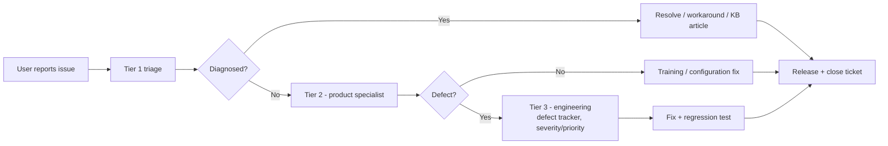

# Maintenance Plan

MeridianEd is a secure, cloud-native, AI-powered, mobile-first school management
ecosystem that centralizes academic, administrative, financial, HR, health,
guidance, research, and operational data for elementary schools, junior/senior
high schools, colleges, universities, school divisions, and regional offices.
This plan covers the operational life of the platform after launch: the
operations calendar, version upgrade and patch policy, maintenance windows
aligned to the DepEd school calendar, support tiers with SLAs, helpdesk
process, runbooks, on-call, cloud cost management, documentation upkeep, and
the annual review. It applies to the target architecture (Next.js 15, NestJS,
PostgreSQL 16, Redis 7, Flutter 3, GCP/Kubernetes) and, at smaller scale, to
the MVP deployment.

> MeridianEd is a placeholder brand — the name is rebrandable at any time.

> **MVP note:** the MVP (single-node deployment) follows the same calendar and
> SLAs at reduced scale: one operations lead, weekly health checks, and the
> same maintenance windows. All automation described here is target
> architecture.

## 1. Operational principles

| Principle | Policy |
|---|---|
| Availability | 99.9% target; maintenance is scheduled, never reactive |
| Zero-data-loss maintenance | All maintenance must respect RPO ≤ 15 min and RTO ≤ 4 h (RTO ≤ 15 min for database HA) |
| Change control | Every production change is a change record: `what`, `why`, `rollback plan`, `owner`, `window` |
| Auditability | All maintenance actions logged to the immutable 7-year audit trail |
| Calendar-aware | No maintenance that degrades service during DepEd-critical periods (§5) |
| Automation first | Manual steps are documented; anything run twice becomes a runbook/script |

## 2. Operations calendar

| Cadence | Tasks | Owner |
|---|---|---|
| Daily | Health dashboards review (Prometheus/Grafana: pods, latency, DB, Redis); overnight batch/report job success check; backup verification (WAL archiving, snapshot taken); dead-letter queues drained; error-rate alerts triaged | On-call |
| Weekly | Capacity review (CPU/memory/disk/storage trends); dependency CVE scan results; staging deploy of patches; P1/P2 defect triage with engineering; on-call handover notes | On-call + QA lead |
| Monthly | Release deployment (feature train); full k6 load baseline re-run; ZAP full scan; restore drill of one snapshot (verified in staging); cost report review vs budget; audit log sampling for tampering | SRE + platform |
| Quarterly | Disaster recovery drill (region failover, RTO/RPO validated); tabletop incident; archive cycle run (old SYs → cold storage); performance review vs §9 targets; vendor/PSP reviews (SMS, email, payments); UAT with pilot school for new features | SRE + QA |
| Annually | Full platform review (§10); major version upgrades (Node LTS, PostgreSQL major, Next.js major); certificate/credential rotation; contract and cost renegotiation; risk register update; offboarding review of privileged accounts | CTO + platform |

## 3. Version upgrade policy

| Component | Policy | Cadence | Notes |
|---|---|---|---|
| Runtime (Node.js) | LTS only; minor updates ≤ 30 days of release; major on LTS transition | Every 1–2 years for major | Verify NestJS/Next.js compatibility in staging first |
| PostgreSQL 16 | Minor (16.x) within 30 days of upstream release; major (17+) only after a full quarter on staging | Minors: ~quarterly; major: annual window (summer) | Use blue/green: new major instance, logical replication, cutover |
| Next.js / React / NestJS | Minor within 45 days; major planned per release train with deprecation audit | Quarterly | Major framework upgrades scheduled in summer break, never during exam periods |
| Flutter | Stable channel; minor ≤ 60 days; app store release per App Store/Play policies | Monthly | Android 9+ / iOS baseline enforced; Chromebook tested |
| Redis 7 | Minor within 30 days; major via new-instance migration | Annual | Cache tiers are ephemeral by design; upgrade risk low |
| GCP services | Follow provider deprecation calendar; no pinned EOL components | Continuous | Terraform-managed; provider upgrades rehearsed in staging |
| Keycloak | Minor ≤ 30 days; major with SSO regression suite (security-critical) | Biannual | SSO outage = availability incident |
| OS images (GKE nodes) | Weekly node pool auto-upgrades; image vulnerabilities patched ≤ 7 days | Weekly | Node pools drained, never in-place patched |

General rules: all upgrades MUST be rehearsed in staging with the full test
suite (deliverable 26) green before production; every upgrade is reversible
(feature flags, blue/green, snapshots); version matrix documented in the
runbooks folder.

## 4. Patch management

| Patch class | Definition | SLA | Path |
|---|---|---|---|
| Critical security | Public exploit, active CVE, DPA/audit exposure | Fix ≤ 24 h; deploy hotfix same day | Hotfix branch → tests → staged roll-out, no waiting for monthly train |
| High security | Unpatched CVE with no public exploit | ≤ 7 days | Include in next patch release (weekly) |
| Regular | Bug fixes, library updates | Next patch or monthly train | Standard release process |
| Data-corruption fix | Any fix touching grades, finance, audit | Reviewed by QA lead + registrar simulation; golden-dataset regression required | Monthly train, extra verification |

Emergency procedure: hotfixes bypass the monthly cadence but NEVER bypass the
pipeline — tests, coverage floors, and rollback plan are mandatory. Every
emergency patch produces a post-incident review within 5 business days.

## 5. Scheduled maintenance windows

| Aspect | Policy |
|---|---|
| Standard window | Sunday 00:00–04:00 Asia/Manila (UTC+8); capacity for 99.9% SLA met even after 4 h |
| No-degradation periods | DepEd exam weeks (typically October, March), periodical grading weeks, SY opening (June), National Achievement Test dates, enrollment surge (May–June) — no planned downtime |
| Allowed operations | Routine restarts, rolling upgrades, index rebuilds, read replica refresh — all online, zero-downtime by design |
| Disallowed | Schema migrations that lock tables during school hours; anything with > 5 min expected impact during school hours |
| Announcement | 7 days advance for planned windows via System Admin + school head notifications; in-app banner + SMS for emergency windows |
| Change window calendar | Published annually against the DepEd school calendar (SY June–March, summer April–May) so schools can plan |

## 6. Support tiers and SLA

| Tier | Audience | Channel | Response (business hours, Manila) | Resolution target |
|---|---|---|---|---|
| Tier 0 — Self-service | All users | Knowledge base, FAQ, in-app help, chatbot (AI roadmap) | Immediate | — |
| Tier 1 — Helpdesk | School staff, parents | In-app ticket, email, phone (08:00–18:00 Mon–Sat) | 4 h acknowledgment | P2 ≤ 5 business days |
| Tier 2 — Product support | Division/region admins, escalated tickets | Escalated from Tier 1 | 2 h | P1 ≤ 5 business days; P0 continuous |
| Tier 3 — Engineering | Escalated defects | On-call engineering | P0: 1 h ack / 24 h fix; P1: 1 business day | Per defect priority (§10 of testing strategy) |

| Priority | Acknowledge | Status updates | Fix |
|---|---|---|---|
| P0 (total outage / data risk) | ≤ 1 h, 24/7 | Every 4 h | ≤ 24 h hotfix |
| P1 (major feature down) | ≤ 4 h | Daily | Next patch (≤ 5 days) |
| P2 (workaround exists) | ≤ 1 business day | Weekly | Next release |
| P3 (minor) | ≤ 2 business days | Monthly triage | Backlog |

## 7. Helpdesk process

| Rule | Policy |
|---|---|
| Ticket fields | School, division/region, role, module, severity, priority, repro steps, screenshots, LRNs (masked) |
| Escalation | Automatic: P0 after 1 h, P1 after 4 h, silent tickets after 2 business days |
| SLA reporting | Monthly report to management: response times, backlog, reopen rate, CSAT |
| Knowledge loop | Every resolved ticket either cites or creates a knowledge base article |
| Parent/student channel | Only through school staff (Tier 1); parents never get direct admin access |

## 8. Runbooks

A runbook directory (target architecture: stored in the repo under
`ops/runbooks/`, mirrored to the on-call tool) MUST cover, at minimum:

| Runbook | Trigger | Key steps |
|---|---|---|
| Database failover | Primary unhealthy / region issue | Promote replica, re-point PgBouncer, verify RTO ≤ 15 min |
| Region failover | GCP region outage | DNS/LB switch, restore from snapshot, verify RTO ≤ 4 h |
| Restore from backup | Data corruption / deletion | Point-in-time restore, integrity check, audit trail review |
| Pod/node failure | Node pool drain | Automatic; verify no in-flight writes lost |
| Queue backlog | Report/notification lag | Scale workers, replay dead letters, notify schools of delay |
| Certificate expiry | TLS/SSO certs | Automated renewal check, manual 48 h pre-warning |
| Cost spike | Budget anomaly | Suspend non-essential jobs, review scaling policies, notify finance |
| Security incident | Breach suspicion | Isolate, preserve logs, invoke DPA (RA 10173) breach protocol, legal + DepEd notification path |
| Deploy failure | Failed release train | Rollback to previous image, restore DB if migration applied, incident review |

Runbooks are tested: failover and restore at least quarterly (DR drill), others
annually; every runbook has an owner and a review date.

## 9. On-call

| Aspect | Policy |
|---|---|
| Rotation | 24/7 primary + secondary engineer (SRE/backend), 1-week shifts, handover checklist, Philippines-friendly hours (Manila + shared Pacific coverage) |
| Response | P0 page ≤ 15 min (PagerDuty-style, with SMS fallback); P1 within business hours |
| Escalation | Secondary → platform lead → CTO; all pages logged to incident timeline |
| Welfare | Compensatory time per shift, max 1 week on-call per engineer, no consecutive weeks |
| Incident record | Every P0/P1 produces a timeline, root cause, and action items in the tracker; P0 reviews within 5 business days |

## 10. Vendor and cloud cost management

| Area | Policy |
|---|---|
| Budget | Annual cloud budget set in PHP; monthly cost report vs budget; > 10% overage triggers review (per scalability plan §2 table) |
| Reserved commitments | GCP committed-use discounts for steady-state compute/DB; reservations re-evaluated quarterly against capacity plan |
| Rightsizing | Weekly review of underutilized pods/instances; autoscaling min/max reviewed per release |
| Storage lifecycle | Cloud Storage lifecycle: standard → nearline (90 days) → coldline (2 SYs) → archive (7 years); orphaned object cleanup job monthly |
| Vendor contracts | SMS/email/PSP vendors reviewed quarterly; unit costs per message/payment tracked and trended |
| Cost per school | KPI: PHP per school per month; reported quarterly; target decline as scale grows |
| FinOps ownership | Platform lead owns the budget; engineers see staging cost dashboards on every deploy |

## 11. Documentation and knowledge base

| Item | Owner | Cadence |
|---|---|---|
| Runbooks | SRE | Updated with every incident; reviewed quarterly |
| Architecture docs (docs/) | Architecture lead | Updated within 2 weeks of any design change |
| API docs (OpenAPI) | Backend team | Generated at release; manual additions reviewed monthly |
| Admin/teacher user guides | Product/QA | Per feature release; translations: English + Filipino |
| Knowledge base (Tier 1) | Support lead | New article per resolved unique ticket; reviewed quarterly for stale content |
| Onboarding docs | Platform lead | Refreshed per quarter and per role change |
| DepEd compliance references | QA/compliance | Checked against DepEd orders each school year (e.g., grading policy changes, SF template updates) |

All docs follow the shared style guide in `docs/.docs-style.md`; outdated
content is flagged during quarterly review and MUST NOT persist beyond two
quarters.

## 12. Annual review

Each year (aligned to the DepEd SY close, April–May, before the June start):

| Review item | Output |
|---|---|
| Availability & SLOs | Actual vs 99.9%; incident report with trends |
| Capacity vs plan | Actual usage vs §2 targets of scalability plan; next-year capacity decision (sharding, regions) |
| Upgrade plan | Major version upgrades scheduled for summer window |
| Security posture | Penetration test (annual), audit log review, DPAct compliance refresh |
| Support performance | SLA attainment, CSAT, backlog age, helpdesk staffing needs |
| Cost | Actual vs budget, unit costs, next-year budget proposal in PHP |
| Product direction | Features vs five-year roadmap (deliverable 30); roadmap adjustments with DepEd feedback |
| People & process | Roles, on-call adequacy, training plan, tooling gaps |
| Documentation | Stale-doc cleanup, runbook updates, KB health |

The annual review is presented to leadership with a written action plan; each
action item gets an owner and a due date, and is tracked like a P2 defect.

---

*MeridianEd — Cloud-Based School Management Ecosystem — Deliverable 28 of 30.*
