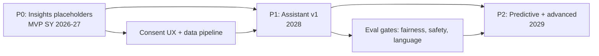

# Future AI Roadmap

MeridianEd is a secure, cloud-native, AI-powered, mobile-first school management
ecosystem that centralizes academic, administrative, financial, HR, health,
guidance, research, and operational data for elementary schools, junior/senior
high schools, colleges, universities, school divisions, and regional offices.
This document is the roadmap for AI features beyond the MVP: phased delivery
(P0/P1/P2), per-capability details (what it does, data needed, model approach,
guardrails, evaluation metrics), and the privacy and compliance framework that
governs every AI feature under RA 10173 (Philippine Data Privacy Act) and
DepEd data governance. The platform targets small open-source models with an
on-prem option as the default posture; third-party APIs are used only with
consent and only for non-PII workloads.

> MeridianEd is a placeholder brand — the name is rebrandable at any time.

> **MVP note:** the MVP ships AI *insights placeholders* only — computed
> aggregates with descriptive labels (e.g., "attendance below class average"),
> no generative AI, no model serving. All generative and predictive features
> below are vision unless marked "MVP".

## 1. Guiding principles

| Principle | Policy |
|---|---|
| Human authority | AI assists; school staff, principals, and Division Offices make all decisions. No automated adverse action on students (e.g., retention, disciplinary) |
| Privacy first | Learner PII (LRN, name, grades, attendance, health) NEVER leaves the tenant boundary or is sent to third-party APIs without documented consent (RA 10173) |
| Open small models | Prefer compact open models (e.g., 1–8B parameter class) served on GKE with on-prem deployment option; use hosted frontier APIs only for non-PII, non-learners workloads |
| Explainability | Every AI output carries the data it was based on and a confidence level; risk predictions include feature explanations |
| Filipino context | Training/tuning data and prompt engineering cover Filipino, English, and code-switching (Taglish) as spoken in Philippine classrooms |
| Measured value | Every capability has evaluation metrics (§8); features that do not improve the metric in pilot are descoped |
| Auditability | AI interactions are logged to the 7-year audit trail; DPAct compliance is checked per feature |

## 2. Phasing overview

| Phase | Window | Scope | Serving |
|---|---|---|---|
| P0 — Insights placeholders | MVP (SY 2026–27) | Rule/heuristic analytics: attendance trends, grade distributions, risk flags by simple thresholds; "AI coming" UI placeholders | SQL/aggregations, no ML |
| P1 — Assistant v1 | 2028 | Lesson/DLL planner, exam & question generator, PPT/rubric/activity generators, writing assistant, OCR scanner, academic analytics, chatbot v1, recommendation engine v1 | Open small LLM + retrieval (RAG) on GKE; OCR open-source; on-prem option |
| P2 — Predictive & advanced | 2029 | Student risk prediction (dropout/at-risk), attendance pattern analysis, AI grading assistant (human-in-the-loop), voice assistant, chatbot v2 (multilingual + code-switching) | Fine-tuned small models; grading with strict HITL |

> **As-built (deployed today):** the MVP already ships generative AI behind
> `GROQ_API_KEY` (policy Q&A chatbot, draft report cards / Form 137 / lesson
> plans / exams, student analytics, enrollment tips). Role access is a
> deliberate per-route decision — see §2a below. All AI replies are sanitized
> server-side (`cleanUpMarkdown` in `server/src/ai.js`) so markdown artifacts
> (`**`, `__`, `*`, `#`, `>` , backticks) never reach the UI; default models
> were refreshed in 2026 (officially `groq` → `openai/gpt-oss-120b`).

## 2a. AI role access matrix (as built)

| AI surface | Roles allowed | Notes |
|---|---|---|
| `/ai/status` | any authenticated user | Provider health only; drives the UI's "AI online/offline" state |
| `/ai/chat` (floating assistant) | all staff + `student` + `parent` | Generic policy/support Q&A; prompts carry no tenant data (only "logged in as <name> (<role>)"). Role-aware scoped answers are a future P2 target (docs below) |
| `/ai/lesson-plan`, `/ai/exam` | all staff (`super_admin`…`guidance`) | No learner data involved |
| `/ai/report` | admin + `teacher` | Teacher calls are scoped to their advisory/assigned sections |
| `/ai/analyze` | admin + `teacher` + `guidance` | Teachers are scoped to their classes; guidance is school-wide |
| `/ai/enrollment-suggest` | admin + `teacher` | Teachers scoped to their classes |
| `/ai/form-137` | admin + `teacher` + `registrar` | Registrars generate official forms |
| `/ai/chat-logs`, `/ai/chat-logs/stats` | admin | Conversation history and usage stats |

The web UI mirrors the matrix: the floating assistant appears for staff and
portal users; the AI workbench (`/ai`) and its per-tool tabs are shown only to
roles the server allow-lists. AI conversations are written to `ai_chat_logs`
(audit-visible, staff/admin-visible) and are **purged on student erasure** to
avoid retaining personal data. Student/parent conversations use
default no-context mode, so chat logs contain no learner PII beyond the
account's own identity.

## 3. Phase P0 — AI insights placeholders (MVP)

The MVP exposes an "AI Insights" area that MUST contain, without any ML:

| Insight placeholder | MVP content |
|---|---|
| Attendance | Simple rules: absence days vs class average; "attention needed" flag at threshold (e.g., > 5 absences in a quarter) |
| Academic performance | Grade trend lines, subject-level averages vs section/division, honors-track progress |
| Report card previews | Descriptive text generated from templates (no LLM): "Grade improved from 82 to 88 in Mathematics" |
| UI posture | Cards labeled "Insight" with an "AI-powered — coming in SY 2028–29" note; infrastructure telemetry planned (usage, consent flags) |

P0 validates the data pipeline, consent UX, and dashboard surfaces that P1/P2
features will fill.

## 4. AI capability catalog

Each capability below is specified as: what it does, data needed, model
approach, guardrails, evaluation metrics, privacy note, target phase.

### 4.1 AI lesson / DLL planner

| Aspect | Detail |
|---|---|
| What it does | Generates draft Daily Lesson Logs/DLLs and Detailed Lesson Plans aligned to the K-12 curriculum guide (learning competencies, MELCs), with objectives, activities, materials, assessment, and time blocks; teacher edits and approves |
| Data needed | K-12/MELC competency catalog (public), subject/grade/quarter context, teacher-selected pedagogy preferences, school calendar (holidays, suspensions) |
| Model approach | RAG over curriculum corpus + small open LLM (7B-class) on GKE; on-prem option; no learner data in prompts |
| Guardrails | Output must be reviewable and editable; source competency IDs cited; no learner PII accepted in input; blocked content list enforced; teacher MUST confirm before DLL is stored as "submitted" |
| Evaluation | Competency-match accuracy ≥ 90% (curriculum alignment rubric by DepEd curriculum experts); teacher approval rate ≥ 70%; time saved per plan |
| Privacy note | No PII involved; still logged for quality |
| Phase | P1 (MVP: none — manual DLL workflow only) |

### 4.2 Exam and question generator

| Aspect | Detail |
|---|---|
| What it does | Drafts quizzes/periodical exam items (multiple choice, T/F, short answer, problem sets) from competencies and past item bank; auto-tags to MELCs and difficulty |
| Data needed | Curriculum competencies, existing item bank (school-owned), grade-level question exemplars (public DepEd resources) |
| Model approach | Small open LLM with item-bank fine-tune or few-shot; on-prem option |
| Guardrails | Item review by teacher before use; bias screens (gender/ethnicity, Filipino context); no learner data; answer-key consistency check; duplicate-item detection against bank |
| Evaluation | Item acceptance rate by teachers ≥ 75%; item-type distribution matches plan; psychometric pilot later (item discrimination in P2) |
| Privacy note | No PII; question banks remain school/division property |
| Phase | P1 |

### 4.3 PPT / rubric / activity generators

| Aspect | Detail |
|---|---|
| What it does | Drafts slide decks from DLLs (summarizes objectives/activities), generates analytic rubrics from competency statements, and suggests classroom activities with materials lists |
| Data needed | DLL content (teacher-authored), competency catalog, template libraries (school-branded themes) |
| Model approach | Small open LLM; deterministic template expansion for PPT structure (PPTX generated server-side, no third-party doc APIs) |
| Guardrails | Rubrics must be editable; activities validated for materials feasibility (no items schools cannot source); brand/template rules enforced |
| Evaluation | PPT draft usable-as-is ≥ 70% of time; rubric alignment to competency ≥ 90%; activity cost estimate within school budget |
| Privacy note | No learner PII |
| Phase | P1 |

### 4.4 Writing assistant

| Aspect | Detail |
|---|---|
| What it does | Helps staff draft memos, announcements, school reports, parent letters (e.g., attendance notice, honor roll letter) in Filipino or English, with formal DepEd register |
| Data needed | Templates (public school forms/letters), school name/context fields only; no learner data |
| Model approach | Small open LLM, RAG over template library; on-prem option |
| Guardrails | No learner PII auto-injected unless staff explicitly attaches (with consent flag); all drafts editable; sensitive topics (disciplinary, guidance referrals) require manual drafting with guidance office sign-off |
| Evaluation | Staff acceptance ≥ 70%; time saved per memo; language quality rated by staff sample |
| Privacy note | Drafts may contain PII only when staff opt in; drafts stored with 7-year audit |
| Phase | P1 |

### 4.5 Student risk prediction (dropout / at-risk)

| Aspect | Detail |
|---|---|
| What it does | Scores learners for risk of dropout / being at-risk (academic, attendance, economic flags) using patterns; produces explainable risk reports with recommended support actions (e.g., guidance referral, ARAL remediation, scholarship leads) |
| Data needed | Longitudinal: grades, attendance, promotion/retention, transfers, LRN history, SF1–SF6 records, optional survey flags (consent-based), school/community context (division-level socio-economic indicators, public data) |
| Model approach | Gradient-boosted tabular models (LightGBM/XGBoost) or small NN, trained on anonymized aggregates; local serving, on-prem capable; no LLM needed |
| Guardrails | HARD: no automated retention/disciplinary decisions (human review only); model cards with feature importance; fairness checks (no gender/ethnicity/economy proxies without explicit validation); yearly re-evaluation against pilot outcomes; DPAct impact assessment required; guardian consent needed before any individual-level flag is shared with guardians |
| Evaluation | Precision/recall on pilot school historical cohort (e.g., at-risk recall ≥ 80% at ≤ 30% false positive); actionability rate (flag → support action taken); fairness parity metrics |
| Privacy note | Highest-sensitivity feature: individual-level predictions are sensitive personal data under RA 10173; restricted to guidance/principal role, full audit, 7-year retention |
| Phase | P2 (P0: simple threshold flags only, no model) |

### 4.6 Attendance / absence pattern analysis

| Aspect | Detail |
|---|---|
| What it does | Detects patterns: chronic lateness windows, post-holiday absence spikes, subject-time-of-day trends, seasonal (planting/harvest, fiesta) absence drivers; surfaces to teachers/guidance |
| Data needed | Attendance records (from the attendance module), school calendar, class schedules, local holiday feeds |
| Model approach | Statistical/ML (anomaly detection, seasonality decomposition) on-prem; small models; explainable output |
| Guardrails | Never names learners in division-level reports; individual insights restricted to school roles; pattern output labeled as correlation, not cause |
| Evaluation | Pattern precision vs guidance-office validation ≥ 80%; action taken rate |
| Privacy note | Aggregates at division level are de-identified; individual views follow P2 consent model |
| Phase | P2 |

### 4.7 Academic analytics

| Aspect | Detail |
|---|---|
| What it does | Cohort analytics: competency mastery per class/school/division, grade-band comparisons, Phil-IRI/ARAL/RMA linkage where available, curriculum review inputs for Division research (BERF) |
| Data needed | Grades, assessments, Phil-IRI/RMA results (public DepEd assessments), demographics aggregates |
| Model approach | Dashboard analytics (OLAP/BI) with statistical models; no generative AI required |
| Guardrails | De-identified aggregates for division/region views; no learner-level drill-down outside school roles; research exports require Division approval |
| Evaluation | Report accuracy vs manual computation; adoption rate; research outputs (BERF studies) enabled |
| Privacy note | Aggregate/de-identified by design; suppression rules for small cells (< 10 learners) to prevent re-identification |
| Phase | P1 |

### 4.8 AI chatbot (Filipino / English / code-switching)

| Aspect | Detail |
|---|---|
| What it does | Answers staff/parent/student questions: school processes, schedules, enrollment steps, fee inquiries (no payment execution), class suspensions, self-service guidance from the knowledge base |
| Data needed | Knowledge base (docs, FAQs, DepEd circulars), school announcements, public calendar; optional consent-linked learner context for personal queries (e.g., own child's attendance summary) |
| Model approach | Small open LLM + RAG over the KB; language packs: Filipino, English, Taglish; on-prem option; hosted APIs only for language quality eval (non-PII) |
| Guardrails | Role-aware: students/parents get scoped answers only for their own context (verified via OIDC session); hard-blocked topics (medical advice, legal, disciplinary outcomes, finances of others); always offer "talk to a human" handoff; no secrets/payment tokens; conversation logging with consent banner; offline fallback message |
| Evaluation | Answer accuracy vs golden Q&A set ≥ 90% (both languages); deflection rate ≥ 50% of Tier-1 tickets; handoff satisfaction |
| Privacy note | Conversations may include PII when consent-linked; default no-context mode; chat logs 7 years, restricted access |
| Phase | P1 (v1, English+Filipino); P2 (code-switching + consent context) |

### 4.9 Recommendation engine (remediation / materials)

| Aspect | Detail |
|---|---|
| What it does | Recommends remediation paths: ARAL lesson plans, practice sets, reading lists matched to competency gaps; material recommendations for teachers |
| Data needed | Learner competency gaps (from grades/assessments), catalog of remediation materials (public + school-uploaded, license-checked), teacher preferences |
| Model approach | Rule-based + collaborative/retrieval hybrid; small LLM for material description; on-prem |
| Guardrails | Recommendations are suggestions only; teacher approves before assignment to learners; materials must be license-clean (no pirated textbooks); no push notifications to parents without consent |
| Evaluation | Recommendation adoption ≥ 60%; gap-closure rate measured next assessment cycle |
| Privacy note | Gap data is learner PII; processed in-tenant, consent per data minimization |
| Phase | P1 (rule-based), P2 (learned ranking) |

### 4.10 OCR document scanner (birth certificates, SF forms)

| Aspect | Detail |
|---|---|
| What it does | Scans/photographs documents (birth certificates, PSA data, old SF forms) and extracts fields into structured records with confidence scores and review queues |
| Data needed | Document images uploaded by registrar; reference templates (PSA birth certificate, SF1–SF6 layouts) |
| Model approach | Open-source OCR (Tesseract + layout models, or compact vision model) served in-tenant; no third-party OCR API for PII documents |
| Guardrails | Extracted data is DRAFT until registrar verifies; PII documents stored encrypted with restricted access; confidence < 95% auto-routes to manual entry; no cross-tenant leakage of document images |
| Evaluation | Field extraction accuracy ≥ 98% post-verification; registrar time saved per document |
| Privacy note | High-sensitivity: documents contain full PII; in-tenant processing mandatory; consent/authorization logging; DPAct compliance mandatory before rollout |
| Phase | P1 |

### 4.11 Voice assistant

| Aspect | Detail |
|---|---|
| What it does | Filipino/English voice interface for common actions: check own schedule (student), ask for class status, dictate memo drafts (staff), accessibility aid for teachers with low vision or high field workload |
| Data needed | Same context as chatbot + speech; voice model in-tenant |
| Model approach | Open speech-to-text (e.g., Whisper-class open models) + small LLM intent router, in-tenant; on-prem option |
| Guardrails | Wake-word explicit; voice transcripts treated as PII logs; no voice for risk/disciplinary topics; accessibility-first design (Chromebook/Android); clear "voice activity" indicator |
| Evaluation | Speech-to-text word error rate ≤ 12% for Filipino English accents (Taglish); task completion ≥ 80% |
| Privacy note | Audio is sensitive; deleted after transcription unless consent-retained; in-tenant processing |
| Phase | P2 |

### 4.12 AI grading assistant (human-in-the-loop)

| Aspect | Detail |
|---|---|
| What it does | Drafts scores for open-response items (essays, problem-solving) and marks rubric levels with rationale; grades are NEVER final until the teacher confirms and signs off; supports the existing grades engine (weighting/transmutation unchanged) |
| Data needed | Rubrics, learner responses (within the school tenant), grade weights from the grades module |
| Model approach | Small open LLM/VLM with rubric-anchored scoring; on-prem serving; batch worker jobs, not real-time |
| Guardrails | HARD human-in-the-loop: teacher approval is mandatory (unapproved = draft); confidence shown per item; teacher can re-score, and their score overrides; flagged for review on confidence < 70%; no autonomous posting to report cards (SF9); yearly fairness audit of scores |
| Evaluation | Agreement with teacher scores ≥ 80% within 1 rubric level; time saved per paper; override rate tracked |
| Privacy note | Learner responses are PII; in-tenant processing mandatory; teacher identity on every final score (audit trail) |
| Phase | P2 |

## 5. Model approach and serving

| Option | Use for | Notes |
|---|---|---|
| Open-source small models (1–8B class) on GKE | All learner-data and PII workloads (4.5, 4.6, 4.8, 4.10, 4.11, 4.12) | Default; GPU worker pool; model registry with versioned artifacts; on-prem appliance option for divisions with strict data residency |
| Hosted frontier APIs | Non-PII utility tasks only (e.g., anonymized language-quality evaluation, public curriculum summarization) | NEVER with learner data; contract clauses: no training on customer data |
| Tabular ML (XGBoost/LightGBM) | Risk prediction, pattern analysis | Cheaper than LLM; on-prem; model cards required |
| RAG pipelines | Chatbot, DLL, writing assistant | Retrieval over tenant-owned corpora; vector index in tenant |
| OCR | Document scanner | Open-source, in-tenant |

All models are versioned with the application; model updates go through the
normal release pipeline (deliverable 26) plus a model-quality gate (§8).

## 6. Guardrails (platform-wide)

| Guardrail | Enforcement |
|---|---|
| Role scoping | AI features inherit RBAC + row-level tenant scoping (deliverable 17); a teacher's prompt cannot address another school's data |
| Prompt injection | System prompt isolation; input/output filtering; blocklists for external URLs and sensitive topics |
| PII redaction | Detection layer on AI inputs/outputs; fails closed (refuses, not degrades) |
| Confidence & provenance | Every AI output shows sources and confidence; low-confidence outputs require human review |
| No adverse automation | Automated decisions that affect a learner's promotion, retention, or discipline are prohibited; humans confirm every consequential action |
| Logging | AI prompts, outputs, and consent events append to the immutable audit trail (7 years) |
| Kill switch | Per-feature feature flags; global AI disable in emergency, with data unaffected |

## 7. Evaluation and quality gates

| Gate | Metric | Passing bar |
|---|---|---|
| Functionality | Per capability metric in §4 | Per capability |
| Safety | Jailbreak/red-team suite (prompt injection, PII extraction, toxicity) | 0 critical findings |
| Fairness | Parity metrics on risk model (by sex, language, region) | No unexplained disparity |
| Language | Filipino/English/Taglish quality eval set | ≥ 90% acceptable |
| Performance | Inference latency, cost per request | p95 < 3 s chat; batch jobs within window |
| Production | Model drift monitoring (prediction distribution shifts) | Alerted, quarterly review |

## 8. Privacy and compliance framework

| Requirement | Policy |
|---|---|
| DPAct (RA 10173) | Privacy Impact Assessment per AI feature before rollout; lawful basis documented; data minimization by design |
| Consent | Opt-in consent for: individual-level predictions (4.5), voice (4.11), parent-facing AI comms; revocable at any time; recorded in audit trail |
| Purpose limitation | Learner data used ONLY for the stated feature; no model training on live tenant data without explicit division-level agreement |
| Data residency | PII processing stays in-tenant (PH or approved region); no third-party API for PII workloads (§5) |
| De-identification | Division/region-level analytics suppress small cells (< 10 learners) |
| DepEd alignment | Features respect DepEd data governance and school-level approvals; BERF research workflows get Division Office approval |
| Breach protocol | AI incidents follow the maintenance plan security incident runbook; DPA breach notification path |

## 9. Delivery order and dependencies

Dependencies: consent infrastructure and the aggregated data warehouse must
exist before P2 predictive features; the OCR and chatbot features are P1
prerequisites for AI grading (P2). Capability priority is set by pilot school
feedback each school year.

---

*MeridianEd — Cloud-Based School Management Ecosystem — Deliverable 29 of 30.*
