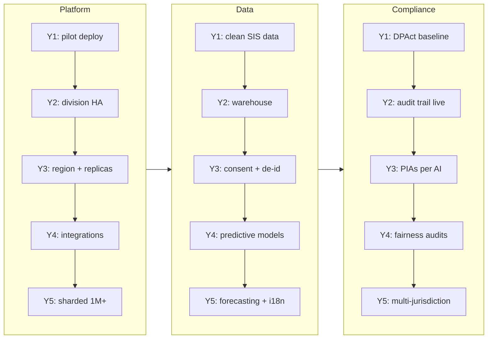

# Five-Year Product Development Roadmap

MeridianEd is a secure, cloud-native, AI-powered, mobile-first school management
ecosystem that centralizes academic, administrative, financial, HR, health,
guidance, research, and operational data for elementary schools, junior/senior
high schools, colleges, universities, school divisions, and regional offices.
This roadmap lays out the product from 2026 to 2030: year-by-year scope,
milestones, key metrics, risks, funding and staffing notes, and the delivery
cadence that keeps MeridianEd aligned with the Philippine DepEd school calendar
(SY June–March, summer April–May) while expanding from a 2-school pilot to a
full ecosystem serving 1M+ users.

> MeridianEd is a placeholder brand — the name is rebrandable at any time.

> **MVP note:** Year 1 below is consistent with the runnable MVP in this repo
> (React 19 + Vite web portal, Express backend, PostgreSQL with `node:sqlite`
> fallback, Capacitor 8 Android wrapper) — MVP capabilities are the floor of
> Year 1; the roadmap describes the production target architecture.

## 1. Guiding principles

| Principle | Policy |
|---|---|
| School-year alignment | Releases land in summer (April–May) or early in the SY; nothing destabilizes exam weeks (October, March) or the June opening |
| Vertical-first | Perfect one school and one division before scaling breadth |
| Reuse over build | Core modules (SIS, Academic, Attendance, Reports) are reused for colleges/universities later, not recreated |
| AI after data | Predictive AI (risk, patterns) comes only after ≥ 1 year of clean longitudinal data |
| Metrics per year | Every year has explicit targets: schools onboarded, active users, uptime (99.9% SLO), revenue (PHP), NPS/CSAT |
| Funded by phases | Each year's scope is funded and staffed before the SY starts; no unfunded promises |

## 2. Year-by-year overview

| Year | Theme | Core scope | Schools | Users | Uptime |
|---|---|---|---|---|---|
| 2026 (Y1) | MVP + pilot | Core modules at 2 pilot schools; web + Android app; SF1–SF6 reports | 2 | ~1,000 | 99.5% pilot |
| 2027 (Y2) | Full academic suite + division rollout | Finance/payroll, app store launch, division-wide rollout, scheduling/DLL | 300 | ~300,000 | 99.9% |
| 2028 (Y3) | Support services + AI v1 | Library, clinic, guidance, property; AI assistant v1; region-level ops | 1,500 | ~1,000,000 | 99.9% |
| 2029 (Y4) | AI suite + integrations | AI suite complete; LIS/payments/Google Workspace integrations; colleges & universities | 4,000+ | ~2,000,000 | 99.9% |
| 2030 (Y5) | Full ecosystem | 1M+ users milestone, regional office analytics, internationalization, full AI | 10,000+ | 3,000,000+ | 99.9% |

## 3. Year 1 — 2026: MVP and pilot school

**Scope.** Deliver the MVP (per repo README): Student Information System with
LRN, attendance, grades with DepEd weights and transmutation, report cards
(SF9) and SF1–SF6 exports, teacher management, parent/student portals, and the
Android wrapper. Two pilot schools in one division, one full SY (2026–27).

| Milestone | Quarter |
|---|---|
| MVP v1 in staging; internal QA complete | Q1 2026 |
| Pilot school onboarding and staff training | Q2 2026 |
| Go-live SY 2026–27 at 2 schools; UAT per testing strategy §8 | June 2026 |
| End-of-SY review: SF outputs validated by Division Office | Q1 2027 (Mar) |

**Metrics.** 2 schools onboarded; ~1,000 users (learners, parents, staff); 100%
SF1–SF6 parity on pilot data; pilot NPS ≥ 40; uptime ≥ 99.5% (pilot SLO).

**Risks.** Registrar work-flow friction (mitigate: shadow-run with existing
manual process in Q1 2026); device constraints (Chromebook/older Android —
mitigate: low-end performance budget); data quality of legacy records
(mitigate: registrar-led cleanup before digitization).

**Funding/staffing.** Seed round; team ~10 (2 backend, 2 frontend, 1 Flutter,
1 QA, 1 DevOps/SRE part-time, 1 product, 1 support lead, 1 pilot coordinator).
Budget in PHP for pilot incentives (data allowances, printing).

## 4. Year 2 — 2027: Full academic suite and division rollout

**Scope.** Complete academic management (curriculum, sections, scheduling,
DLL/lesson plan workflow, assessments), Finance (fees, invoicing, cashier,
PHP-ledger), HR/payroll basics for school staff, communication module, app
store releases (Play + App Store), and rollout to the full division (~300
schools) with the maintenance and support model of deliverable 28.

| Milestone | Quarter |
|---|---|
| Academic suite + scheduling live in pilot division | Q2 2027 |
| Android + iOS app store release | Q2 2027 |
| Finance/payroll live at 20 lead schools | Q3 2027 |
| Division-wide rollout (300 schools) complete | Q1 2028 |
| First production analytics (division dashboard) | Q4 2027 |

**Metrics.** 300 schools onboarded; ~300,000 users; 99.9% uptime sustained
(validated by quarterly DR drill); support SLA attainment ≥ 95%; paid plans
(gross revenue milestone per division).

**Risks.** Rollout velocity vs training capacity (mitigate: school-trainer
model — train division ICT staff as trainers); connectivity in rural schools
(mitigate: offline-first Flutter app, SMS fallback for notifications);
scale surprises (mitigate: scalability plan phases H1–H2, load tests before
each wave).

**Funding/staffing.** Series A or grants (DepEd/DEP-BERF-adjacent, private
foundations); team ~30 incl. support tier; division onboarding team.

## 5. Year 3 — 2028: Support services and AI v1

**Scope.** Library (catalog, loans), Clinic (health records, medicine log,
immunization), Guidance (referrals, case notes with role restrictions),
Property management (custodian workflows); AI insights placeholders (P0 of
deliverable 29) mature into AI assistant v1 (lesson planner, exam generator,
chatbot, OCR scanner); region-level operations with regional dashboards and
cross-division analytics (de-identified).

| Milestone | Quarter |
|---|---|
| Support services modules live in pilot region | Q2 2028 |
| AI assistant v1 (LLM+RAG, P1 scope) pilot at 50 schools | Q3 2028 |
| Region-level reporting (de-identified) live | Q4 2028 |
| Data warehouse + consent infrastructure (AI prerequisites) | Q2 2028 |

**Metrics.** 1,500 schools; ~1M users; AI assistant adoption ≥ 30% of pilot
teachers; chatbot deflection ≥ 50% of Tier-1 tickets; uptime 99.9%; cost per
school declining.

**Risks.** AI quality/trust (mitigate: evaluation gates per §7 of AI roadmap;
human-in-the-loop defaults); region-wide analytics re-identification (mitigate:
small-cell suppression); scope creep from division requests (mitigate:
roadmap gatekeeping).

**Funding/staffing.** Series B; team ~70 incl. data/AI (2 ML engineers,
1 prompt/evals engineer), regional success managers; model/GPU budget for
on-prem AI serving.

## 6. Year 4 — 2029: AI suite complete and integrations

**Scope.** Complete the AI suite: risk prediction (dropout/at-risk), attendance
pattern analysis, AI grading assistant (human-in-the-loop), voice assistant,
code-switching chatbot (P2 of deliverable 29); integrations: LIS (Learner
Information System) data exchange, payments gateways (GCash, Maya, BPI),
Google Workspace SSO + Classroom flows; expansion to colleges and universities
using level-agnostic modules.

| Milestone | Quarter |
|---|---|
| Predictive risk + pattern analysis live (guidance-led, consent UX) | Q2 2029 |
| AI grading assistant pilot with teachers | Q3 2029 |
| LIS + payments + Google Workspace integrations | Q3–Q4 2029 |
| First university/college tenant (tertiary pilot) | Q4 2029 |

**Metrics.** 4,000+ schools incl. tertiary; ~2M users; AI risk model recall ≥
80% at ≤ 30% false positives (pilot cohort); grading assistant agreement ≥ 80%;
integration uptime 99.9%; revenue diversification (HEI segment).

**Risks.** DPAct exposure on predictive features (mitigate: Privacy Impact
Assessment, consent UX, fairness audits before launch); HEI feature divergence
(mitigate: config-driven level adaptation, not forks); vendor dependence
(payments/SMS — mitigate: adapter layer per scalability plan).

**Funding/staffing.** Team ~120; compliance officer + data protection officer
engagement formalized; AI infra dedicated budget; partnerships (PSPs, Google
for Education reseller path).

## 7. Year 5 — 2030: Full ecosystem

**Scope.** Full ecosystem: 1M+ active users milestone (3M+ accounts), regional
office analytics with forecasting, internationalization (English default with
i18n framework; ASEAN expansion evaluated), complete AI suite GA (all of §4 in
deliverable 29), marketplace of content/templates, and self-serve onboarding
for new schools/divisions.

| Milestone | Quarter |
|---|---|
| 1M active users milestone | Q1 2030 |
| Full AI suite GA (all capabilities, no beta flags) | Q2 2030 |
| Regional office analytics GA | Q2 2030 |
| i18n + first international pilot (ASEAN) | Q3 2030 |
| Ecosystem marketplace + partner APIs (public developer portal) | Q4 2030 |

**Metrics.** 10,000+ schools; 3M+ registered, 1M+ monthly active; uptime 99.9%
(and 7 consecutive quarters); annual recurring revenue target met; NPS ≥ 50;
international pilot ≥ 10 schools.

**Risks.** Scale at 1M+ (mitigate: sharding plan H4–H5, rehearsed resharding);
regulatory divergence in new markets (mitigate: local privacy counsel,
data-residency on-prem option per AI roadmap); AI over-reliance (mitigate:
continued human-authority guardrails, annual AI fairness audit).

**Funding/staffing.** Series C/self-sustaining target; team ~200; international
expansion pod; every region has a named success manager.

## 8. Feature delivery cadence

| Cadence | What | Alignment |
|---|---|---|
| Monthly release train | Bug fixes, small features, dependency patches | Never in exam weeks or June opening week |
| Quarterly release | Feature themes (e.g., Q1 finance, Q2 library) | Summer window for majors (April–May) |
| SY cycle | Big releases at SY start (June) and SY break (April) | DepEd school calendar |
| AI model releases | Model updates via normal pipeline + AI quality gate (AI roadmap §7) | Quarterly, with eval gate |
| Emergency hotfixes | P0/P1 per testing strategy §10 | Any time; pipeline never bypassed |

Every feature follows: design → pilot school feedback (Y1–Y2 pilot remains the
reference tenant) → staged rollout (10 → 100 → all schools) → GA with
documentation and training pack.

## 9. Cross-cutting trajectories

Governance: an annual roadmap review (aligned to the maintenance plan annual
review, April–May) validates metrics, re-prioritizes with Division/Region
feedback, and revises funding. The 99.9% availability SLO, RPO ≤ 15 minutes,
and RTO ≤ 4 hours hold from Y2 onward; pilot-year SLOs are 99.5% by design.

---

*MeridianEd — Cloud-Based School Management Ecosystem — Deliverable 30 of 30.*
