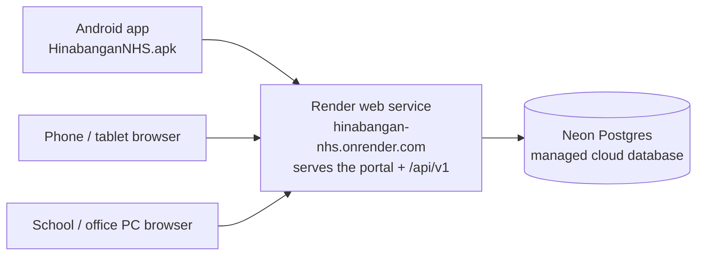

# Cloud Deployment Guide — Render + Neon (Free Tier)

MeridianEd is a placeholder brand — the name is rebrandable at any time.

This guide connects the runnable MVP (API server + web portal + Android app) to a
public cloud server so **any device** — phones, tablets, laptops, office PCs — can
sign in over the internet from anywhere.

> **MVP note:** the runnable MVP uses Express (Node 22) + PostgreSQL with a
> `node:sqlite` local fallback, a React 19 + Vite web portal, and a Capacitor 8
> Android wrapper. This guide deploys exactly that MVP on free-tier hosting; the
> full target architecture (GCP, Kubernetes, Keycloak) is described in
> [18-deployment-architecture.md](18-deployment-architecture.md) and is not part
> of this free-tier deployment.

## 1. What the deployment looks like



- One Render web service serves **both** the web portal (static files) and the
  REST API (`/api/v1`), so "the cloud server" is a single public URL.
- Data lives in a managed PostgreSQL database on Neon — it is not tied to the
  server, so restarts, redeploys, and Render's free-tier sleeping never lose data.
- Everything below costs **₱0**.

## 2. Prerequisites

| Item | Where | Cost |
|---|---|---|
| GitHub account | https://github.com | Free |
| Render account | https://render.com (sign in with GitHub) | Free |
| Neon account | https://neon.tech (needed only if you skip the blueprint's database) | Free |

The school needs no static IP, no port forwarding, and no special internet plan.

## 3. Push the project to GitHub

The project root is `school-system/` (the folder containing `server/`, `web/`,
`database/`, `docs/`, `render.yaml`, and `package.json`).

### Option A — upload without installing Git (quickest)

1. Go to https://github.com/new, name it e.g. `hinabangan-nhs-sms`, set it
   **Private**, then **Create repository**.
2. On the empty repo page choose **uploading an existing file**.
3. Drag the **contents** of `school-system/` into the browser (not the folder
   itself; `render.yaml` must sit at the repo root). Uploading tens of thousands
   of files in one drag sometimes fails — if so, upload in 2–3 batches
   (`server/`, `web/src` + `web/public` + root files last).
4. **Do not upload**: `node_modules/`, `web/dist/`, `server/data/`, any `.env` —
   the `.gitignore` already lists these, but browser upload ignores `.gitignore`,
   so just skip those folders when dragging.
5. Click **Commit changes**.

### Option B — install Git and push (recommended for updates)

1. Install Git from https://git-scm.com (Windows: accept defaults).
2. Open a terminal in `school-system/` and run:

```
git init
git add .
git commit -m "Hinabangan NHS School Management System — cloud deploy"
gh repo create hinabangan-nhs-sms --private --source=. --push
```

(`gh` is the GitHub CLI — it will ask you to log in once. Without `gh`, add the
remote manually at https://github.com/new, then
`git remote add origin https://github.com/YOU/hinabangan-nhs-sms.git` and
`git push -u origin main`.)

## 4. Deploy on Render

`render.yaml` in the repo root is a **Blueprint**: it declares the web service
in one file.

1. Go to https://render.com → **New → Blueprint**.
2. Connect GitHub and select the `hinabangan-nhs-sms` repository.
3. Render reads `render.yaml` and shows the Web Service `hinabangan-nhs`
   (Node 22, free).
4. Click **Apply**. Render builds the web portal (`npm run build`) and starts
   the server (`npm start`). First build takes ~5–10 minutes.
5. Add the database connection string (section 4a) before/after the first
   build — the app auto-migrates the schema on first boot.

### 4a. Connect a database with NO expiry (Neon free — recommended)

Render's own free PostgreSQL **expires 30 days after creation** — unsuitable
for a school system in public use. **Neon** free tier has **no expiry** and
never deletes data (it only sleeps after ~7 days idle and wakes automatically
on the next request).

1. Go to https://neon.tech and sign in (GitHub/Google — free).
2. **Create a project** — pick a region close to the Philippines
   (e.g. **Singapore**). Leave the rest as defaults.
3. Copy the **connection string** (starts with `postgresql://...neon.tech/...`).
4. On Render: **hinabangan-nhs** → **Environment** → set **DATABASE_URL** to
   that string → **Save** → **Deploy latest commit**.
5. First boot runs all migrations automatically and seeds the report
   taxonomy + superadmin + staff accounts. If you set `SUPERADMIN_PASSWORD`
   in the Render environment, that value becomes the superadmin password on
   first boot; otherwise the seed generates a random password and prints the
   one-time credentials to the boot log / `accounts.txt`.
6. Sign in as `superadmin` with that password and change it right away
   (key icon, top bar).

No maintenance needed afterwards: the Neon database never expires.

## 5. Environment variables

`render.yaml` declares every variable the app uses. Ones with `sync: false`
are **set manually** in the dashboard (Render → hinabangan-nhs → Environment) —
they are never fetched from the repo because they are secrets or per-install
values. The Bootstrap ones are filled in automatically.

| Key | Where | Purpose |
|---|---|---|
| `DATABASE_URL` | manual (sync: false) | Your Neon connection string (section 4a) |
| `APP_URL` | manual (sync: false) | Public base URL of the app — used for password-reset links |
| `JWT_SECRET` | auto-generated | Signs login tokens (never reuse across installs) |
| `SUPERADMIN_PASSWORD` | manual (optional) | Sets the superadmin password on the **first boot** (8+ chars). After that it is ignored — existing passwords are never reset |
| `SMTP_HOST/USER/PASS/MAIL_FROM` | manual (optional) | Outgoing mail — **required** for "forgot password" codes to leave the server |
| `SMS_PROVIDER_URL/TOKEN/SENDER` | manual (optional) | Outgoing SMS for the same reset codes (and notifications) |
| `GROQ_API_KEY` | manual (optional) | Enables the AI assistant (staff/students/parents per the access matrix) |
| `SENTRY_DSN` + `VITE_SENTRY_DSN` | manual (optional) | Server + web error tracking |
| `FCM_SERVICE_ACCOUNT` | manual (optional) | Firebase service account JSON for Android push |
| `BACKUP_ENABLED` | `'1'` (declared) | Automated backups; pair with the `R2_*` vars (manual) to store them off Render |
| `NODE_VERSION` | `22` (declared) | Node runtime |

Generate your own secret if you are deploying manually:

```
node -e "console.log(require('crypto').randomBytes(48).toString('hex'))"
```

## 6. Seeding (automatic)

On every boot (`SEED_ON_BOOT=1` in the Blueprint) the server ensures the
foundation only: the **report types taxonomy**, **superadmin**, and the **30
staff accounts**. Existing passwords are never reset; if the superadmin account
was just created (its password has never been changed), a set
`SUPERADMIN_PASSWORD` is applied once on first boot.

**Demo data is gone.** On first deploy, a one-shot cleanup removed all demo
rows (students, teachers, sections, subjects, grades, attendance,
announcements, research, assessments, interventions, question bank, etc.);
only user-entered records survive. The purge is flagged in `system_flags` so
it never runs twice.

Optional: set `DEMO_SEED=1` in Render **only** on a fresh database if you
want a populated sandbox — it seeds demo students/grades/attendance once and
never resets them.

The superadmin password is **randomly generated** on first seed (unless you set
`SUPERADMIN_PASSWORD`). With `DEMO_SEED=1` the credentials are written to
`accounts.txt`; otherwise they are printed in the boot log once. Either way,
the password cannot be recovered once the log is gone, so change it to
something you know and store the new one safely.

To force a custom superadmin password **without writing it into the repo**, set
an env var on the Render service before the first successful boot:

1. Render dashboard → **hinabangan-nhs** → **Environment**.
2. Add `SUPERADMIN_PASSWORD` with your chosen value (8+ chars).
3. Save & redeploy. First boot applies it; later boots leave the password alone.

Migrations run automatically on every server start, so future schema updates
need no manual step.

## 7. First sign-in (from any device)

1. Open `https://hinabangan-nhs.onrender.com` in any browser (the exact URL is
   shown in the Render dashboard top-left).
2. Sign in as `superadmin` with the boot-set password (from
   `SUPERADMIN_PASSWORD` or the boot log / `accounts.txt`).
3. Create accounts for the principal, registrar, teachers, etc. in the
   **Users** module (or hand out the seeded staff accounts from `accounts.txt`).
4. **Change the superadmin password immediately**: click the key icon in the
   top bar and use **Change password**. Anyone can also change their own
   password there at any time.

On the phone/tablet:

- **Browser:** bookmark the URL, "Add to Home Screen" optionally.
- **Android app:** install `HinabanganNHS.apk` (repo root) on each device
  (share it over USB/email/GDrive). On the login screen, set the
  **Server address** to `https://hinabangan-nhs.onrender.com/api/v1` and sign
  in with the same usernames/passwords.

## 8. Free-tier behavior (know before you deploy)

- Render free web services **sleep after 15 minutes of no traffic**. The first
  request after idle takes ~30–60 seconds to wake up. Acceptable for school
  hours; upgrade (≈$7/mo) if not.
- Neon free storage limit: 3 GB — tens of thousands of student records fit
  easily; exports and media should be stored elsewhere (the upload folder is
  `server/data/uploads`).
- Neon free autosuspends after ~7 days of no activity and wakes automatically
  on the next request; **data is never deleted and the database never
  expires**.
- The URL is a `*.onrender.com` subdomain; HTTPS is automatic.
- 750 instance-hours per month — a sleeping service consumes ~0.

## 9. Backing up

- **Nightly**: Neon keeps 7 days of automatic backups on free tier. Download a
  copy from the Neon dashboard whenever you change major data.
- **On demand** (Render Shell):

```
cd server
node -e "fetch(process.env.DATABASE_URL || '')"   # no-op check
```

  Better: use Neon's **Dump/restore** option in its dashboard (pg_dump runs
  there — no local tooling needed) or `pg_dump "$DATABASE_URL" > backup.sql`
  from any PC with PostgreSQL installed.

Full backup policy: [19-backup-strategy.md](19-backup-strategy.md).

## 10. Updating the deployment later

- Every `git push` to the repo's main branch triggers a rebuild on Render.
- Before pushing, rebuild locally to catch errors: `cd web && npm run build`.
- Data is never lost on redeploy — it lives in Postgres, not the server.

## 11. Troubleshooting

| Symptom | Fix |
|---|---|
| First load takes ~1 min | Free-tier cold start — wait for wake-up; refresh once |
| `GET /api/v1/...` fails on the APK | Login screen → Server address must be `https://<your-service>.onrender.com/api/v1` (no trailing slash) |
| Build fails with "Node version" error | Set env var `NODE_VERSION=22` and redeploy |
| Login says "Invalid username or password" | Check `SUPERADMIN_PASSWORD` override, or sign in with the seeded staff accounts from `accounts.txt` |
| "ECONNREFUSED" in server logs | `DATABASE_URL` missing or mistyped — check section 5 |

---
*MeridianEd — Cloud-Based School Management Ecosystem — Deliverable 31.*