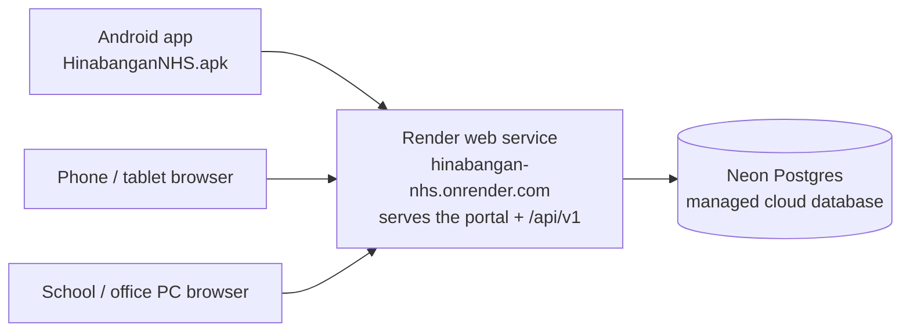

# Cloud Deployment Guide — Render + Neon (Free Tier)

MeridianEd is a placeholder brand — the name is rebrandable at any time.

This guide connects the runnable MVP (API server + web portal + Android app) to a
public cloud server so **any device** — phones, tablets, laptops, office PCs — can
sign in over the internet from anywhere.

> **MVP note:** the runnable MVP uses Express (Node 22) + PostgreSQL with a
> `node:sqlite` local fallback, a React 19 + Vite web portal, and a Capacitor 8
> Android wrapper. This guide deploys exactly that MVP on free-tier hosting; the
> full target architecture (GCP, Kubernetes, Keycloak) is described in
> [18-deployment-architecture.md](18-deployment-architecture.md) and is not part
> of this free-tier deployment.

## 1. What the deployment looks like



- One Render web service serves **both** the web portal (static files) and the
  REST API (`/api/v1`), so "the cloud server" is a single public URL.
- Data lives in a managed PostgreSQL database on Neon — it is not tied to the
  server, so restarts, redeploys, and Render's free-tier sleeping never lose data.
- Everything below costs **₱0**.

## 2. Prerequisites

| Item | Where | Cost |
|---|---|---|
| GitHub account | https://github.com | Free |
| Render account | https://render.com (sign in with GitHub) | Free |
| Neon account | https://neon.tech (needed only if you skip the blueprint's database) | Free |

The school needs no static IP, no port forwarding, and no special internet plan.

## 3. Push the project to GitHub

The project root is `school-system/` (the folder containing `server/`, `web/`,
`database/`, `docs/`, `render.yaml`, and `package.json`).

### Option A — upload without installing Git (quickest)

1. Go to https://github.com/new, name it e.g. `hinabangan-nhs-sms`, set it
   **Private**, then **Create repository**.
2. On the empty repo page choose **uploading an existing file**.
3. Drag the **contents** of `school-system/` into the browser (not the folder
   itself; `render.yaml` must sit at the repo root). Uploading tens of thousands
   of files in one drag sometimes fails — if so, upload in 2–3 batches
   (`server/`, `web/src` + `web/public` + root files last).
4. **Do not upload**: `node_modules/`, `web/dist/`, `server/data/`, any `.env` —
   the `.gitignore` already lists these, but browser upload ignores `.gitignore`,
   so just skip those folders when dragging.
5. Click **Commit changes**.

### Option B — install Git and push (recommended for updates)

1. Install Git from https://git-scm.com (Windows: accept defaults).
2. Open a terminal in `school-system/` and run:

```
git init
git add .
git commit -m "Hinabangan NHS School Management System — cloud deploy"
gh repo create hinabangan-nhs-sms --private --source=. --push
```

(`gh` is the GitHub CLI — it will ask you to log in once. Without `gh`, add the
remote manually at https://github.com/new, then
`git remote add origin https://github.com/YOU/hinabangan-nhs-sms.git` and
`git push -u origin main`.)

## 4. Deploy on Render

`render.yaml` in the repo root is a **Blueprint**: it declares the web service
and the PostgreSQL database in one file.

1. Go to https://render.com → **New → Blueprint**.
2. Connect GitHub and select the `hinabangan-nhs-sms` repository.
3. Render reads `render.yaml` and shows two resources:
   - Web Service `hinabangan-nhs` (Node 22, free)
   - PostgreSQL `hinabangan-nhs-db` (free)
4. Click **Apply**. Render creates the database, then builds the web portal
   (`npm run build`) and starts the server (`npm start`). First build takes
   ~5–10 minutes.

### Manual alternative (skip the Blueprint if it is unavailable)

1. At https://neon.tech, create a project (`pitr` region close to Samar, e.g.
   Singapore), copy the **connection string** (starts with `postgresql://`).
2. On Render: **New → Web Service** → pick the repo.
   - Build command: `npm run build`
   - Start command: `npm start`
   - Environment variables (see section 5).
3. Render hosts its own managed Postgres too (**New → PostgreSQL** on Render, free
   plan) and gives you the connection string either way.

## 5. Environment variables

Set these on the service (Dashboard → the service → **Environment**):

| Key | Value |
|---|---|
| `DATABASE_URL` | The Neon (or Render) connection string — the Blueprint fills this automatically from `hinabangan-nhs-db` |
| `JWT_SECRET` | A long random string — the Blueprint generates one automatically |
| `NODE_VERSION` | `22` |

Generate your own secret if you are deploying manually:

```
node -e "console.log(require('crypto').randomBytes(48).toString('hex'))"
```

## 6. Seed the database (one-time)

The database starts empty. Create the super administrator and the school staff
accounts (done automatically with passwords, see `accounts.txt` in the repo):

1. In Render, open the **hinabangan-nhs** service → **Shell** (top-right).
2. Run:

```
cd server
npm run seed
```

3. The log shows `+ user superadmin (super_admin) / password: ...` and 30+
   staff accounts. Seeding is **idempotent** — running it again never resets
   passwords or deletes data.

Migrations run automatically on every server start, so future schema updates
need no manual step.

## 7. First sign-in (from any device)

1. Open `https://hinabangan-nhs.onrender.com` in any browser (the exact URL is
   shown in the Render dashboard top-left).
2. Sign in as `superadmin` with the password from the seed log
   (`MeridianEd2026!` in the local seed — verify the one printed on your deploy).
3. Create accounts for the principal, registrar, teachers, etc. in the
   **Users** module (or hand out the seeded staff accounts from `accounts.txt`).
4. **Immediately set a strong superadmin password** and keep `JWT_SECRET`
   secret — anyone with it can forge sessions.

On the phone/tablet:

- **Browser:** bookmark the URL, "Add to Home Screen" optionally.
- **Android app:** install `HinabanganNHS.apk` (repo root) on each device
  (share it over USB/email/GDrive). On the login screen, set the
  **Server address** to `https://hinabangan-nhs.onrender.com/api/v1` and sign
  in with the same usernames/passwords.

## 8. Free-tier behavior (know before you deploy)

- Render free web services **sleep after 15 minutes of no traffic**. The first
  request after idle takes ~30–60 seconds to wake up. Acceptable for school
  hours; upgrade (≈$7/mo) if not.
- Free Postgres storage limit: 256 MB — thousands of students' records fit
  easily; exports and media should be stored elsewhere (the upload folder is
  `server/data/uploads`).
- The URL is a `*.onrender.com` subdomain; HTTPS is automatic.
- 750 instance-hours per month — a sleeping service consumes ~0.

## 9. Backing up

- **Nightly**: Neon keeps 7 days of automatic backups on free tier. Download a
  copy from the Neon dashboard whenever you change major data.
- **On demand** (Render Shell):

```
cd server
node -e "fetch(process.env.DATABASE_URL || '')"   # no-op check
```

  Better: use Neon's **Dump/restore** option in its dashboard (pg_dump runs
  there — no local tooling needed) or `pg_dump "$DATABASE_URL" > backup.sql`
  from any PC with PostgreSQL installed.

Full backup policy: [19-backup-strategy.md](19-backup-strategy.md).

## 10. Updating the deployment later

- Every `git push` to the repo's main branch triggers a rebuild on Render.
- Before pushing, rebuild locally to catch errors: `cd web && npm run build`.
- Data is never lost on redeploy — it lives in Postgres, not the server.

## 11. Troubleshooting

| Symptom | Fix |
|---|---|
| First load takes ~1 min | Free-tier cold start — wait for wake-up; refresh once |
| `GET /api/v1/...` fails on the APK | Login screen → Server address must be `https://<your-service>.onrender.com/api/v1` (no trailing slash) |
| Build fails with "Node version" error | Set env var `NODE_VERSION=22` and redeploy |
| Login says "Invalid username or password" | Seed was not run (section 6), or the account is a seeded staff account with a password from `accounts.txt` |
| "ECONNREFUSED" in server logs | `DATABASE_URL` missing or mistyped — check section 5 |

---
*MeridianEd — Cloud-Based School Management Ecosystem — Deliverable 31.*